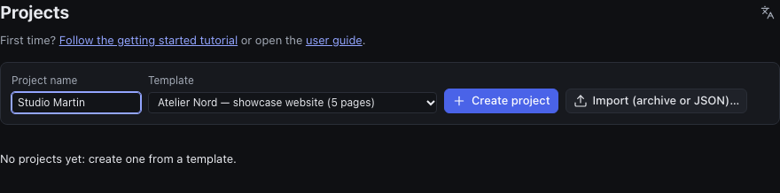
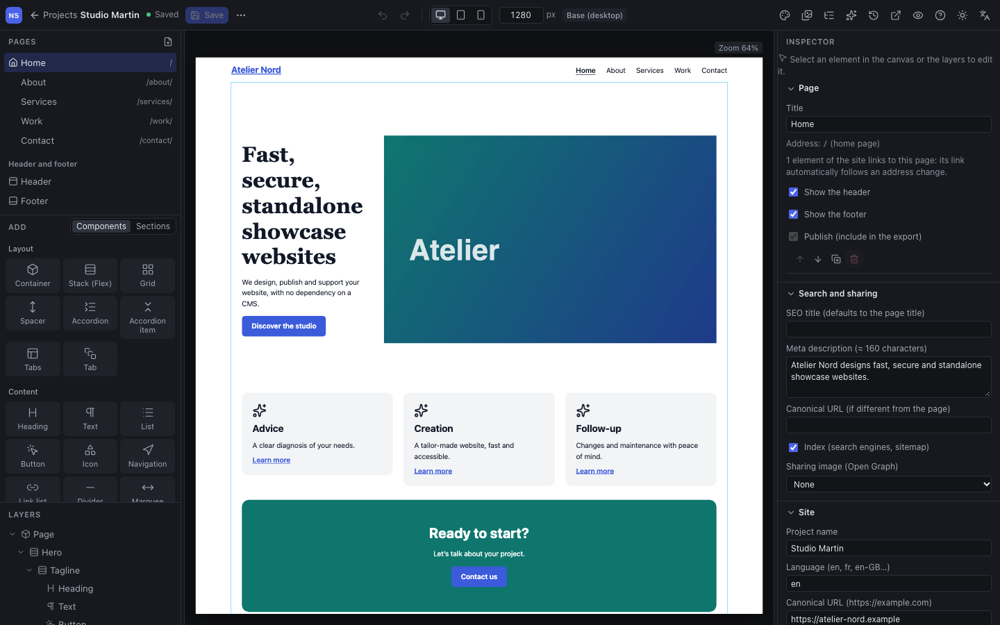
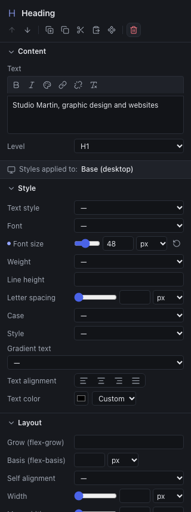
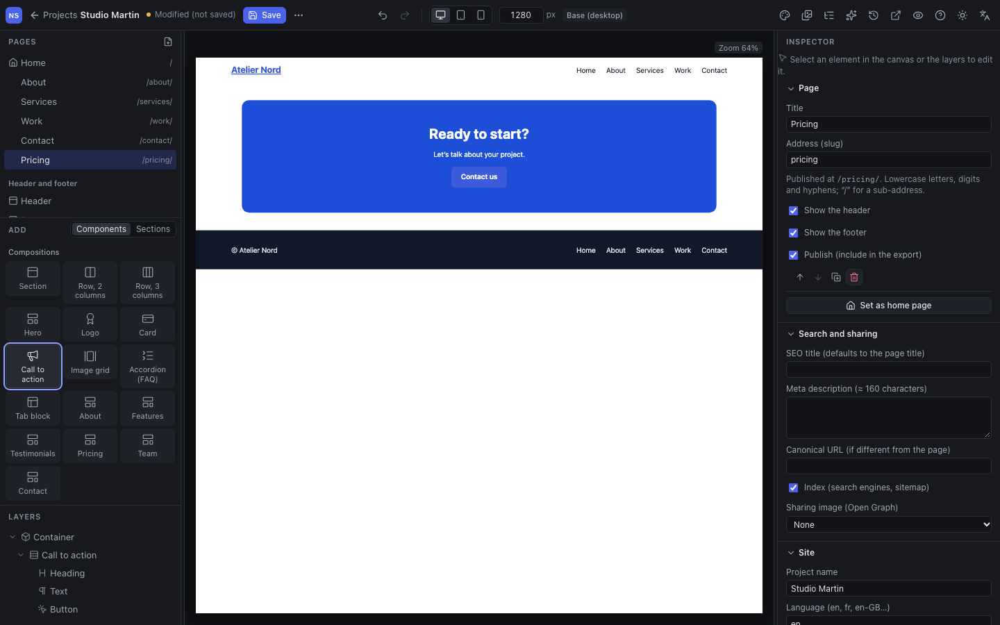
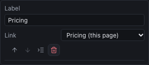
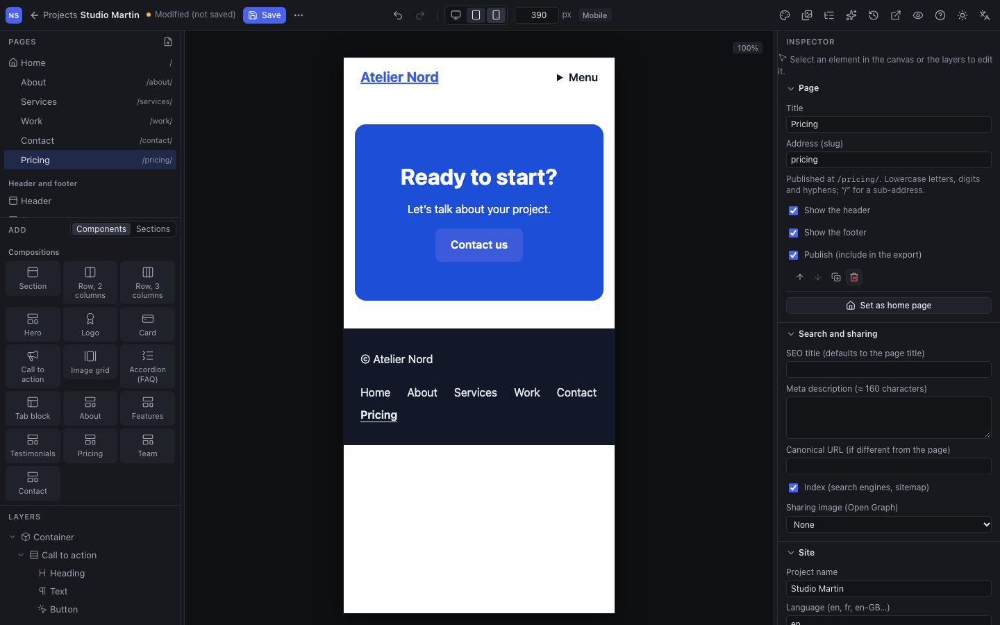
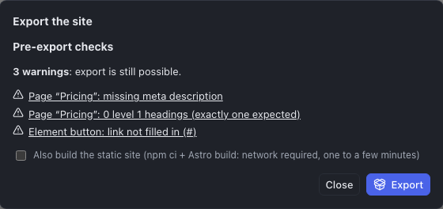

In this tutorial, you start from the "Atelier Nord" template, a five-page showcase site. You will customize the home page, add a "Pricing" page to the site and the menu, check the display on mobile, then export the site.

> Nothing you do here is published: the Studio is a workshop. You can delete this trial project at the end.

## Step 1: create the project

Open the Studio. The **Projects** screen lists the team's sites.

1. In **Project name**, type for instance "Studio Martin".
2. In **Template**, choose **Atelier Nord — showcase website (5 pages)**, in the "Complete sites" group. (The French version of the template is marked "French".)
3. Click **Create project**.

The other templates, under "Starter pages", create a one-page site: useful to start from scratch, less so to discover.

## Step 2: discover the editor

The project opens on the home page.

- **On the left**, from top to bottom: the site's **pages**, the **Add** library (the elements to insert) and the page's **layers**.
- **In the middle**, the **canvas**: the page as it will be published.
- **On the right**, the **inspector**. When nothing is selected, it shows the settings of the page and the site.
- **At the top**, the toolbar: save, undo, screen size, and the site panels (design system, media library, menus…).

The chapter [The interface](02-interface.md) details each area.

## Step 3: change the home page heading

1. In the canvas, click the large heading "Fast, secure, standalone showcase websites". It gets a frame and its row lights up in the layers.
2. In the inspector, **Content** section, replace the **Text** with "Studio Martin, graphic design and websites".
3. Click elsewhere or press <kbd>Tab</kbd>: the canvas updates.

Below the content, the **Style**, **Layout** and **Spacing** sections set the element's appearance. Try the **Font size**: the slider and the field do the same thing.

> **A mistake?** <kbd>⌘</kbd> <kbd>Z</kbd> (<kbd>Ctrl</kbd> <kbd>Z</kbd> on Windows) undoes, <kbd>⇧</kbd> <kbd>⌘</kbd> <kbd>Z</kbd> redoes. The arrows of the toolbar do the same.

## Step 4: add a "Pricing" page

1. In the **Pages** panel, click the **Add a page** icon (the sheet with a +). A "New page" appears and opens.
2. The inspector shows its settings. Type the **Title** "Pricing", then the **Address (slug)** "pricing": the page will be published at `/pricing/`.
3. The page is empty, except for the header and footer shared by the whole site. In **Add**, **Components** tab, scroll down to the **Compositions** and click **Call to action**. The section is inserted into the page.

You can also **drag** an element of the library to the wanted place in the canvas: a marker shows where it will be dropped, and the Studio refuses impossible places.

## Step 5: add the page to the menu

A new page does not appear in the navigation by itself: you decide.

1. In the toolbar, click **Menus** (the list icon, on the right).
2. Under **Main menu**, click **Add an entry** (at the bottom of the list).
3. In the new entry, type the **Label** "Pricing" and choose the "Pricing" page in **Link**.

The link appears at once in the canvas header. The link follows the page: if you later change its address, the menu stays right. Click **Menus** again to return to the inspector.

## Step 6: check on mobile

In the toolbar, click the **Mobile** icon (the phone). The canvas takes the width of a phone (390 px): the navigation collapses behind a "Menu" button. On the home page, the columns of the hero and the cards stack.

While you are on mobile, the styles you change apply **only to mobile**: the "Styles applied to: Mobile" indication in the inspector reminds you. It is the equivalent of Elementor's responsive mode. Go back to **Desktop** before continuing.

## Step 7: save

Click **Save** at the top left, or press <kbd>⌘</kbd> <kbd>S</kbd>. The status changes from "Modified (not saved)" to "Saved".

> The Studio does not save automatically. It warns you if you close the tab with unsaved changes.

## Step 8: export the site

1. Open the **⋯** menu (More actions), next to the Save button, and choose **Export site (Astro)…**.
2. The Studio starts with the **pre-export checks**.

**Warnings** do not prevent exporting, but they deserve your attention. Click one of them to go straight to the element concerned. Here:

- the Pricing page has no **meta description**: when nothing is selected, the **Search and sharing** section of the inspector offers it;
- it has no **level 1 heading**: select the heading "Ready to start?" and set its **Level** to H1 (each page must have one, for search engines and accessibility);
- the **button** leads nowhere: select it and choose the "Contact" page in its **Link**.

**Blocking errors**, on the other hand, must be fixed before exporting (a linked page that no longer exists, for instance).

3. Tick **Also build the static site**, then click **Export**. Allow one to a few minutes.
4. Two **Download (.tar.gz)** links appear:
   - the **Astro sources**, for a developer who would take the site over;
   - the **static site**, the HTML, CSS and image files ready to upload to a host.

The chapter [Publish and deliver](11-publish-and-deliver.md) explains going online.

## Well done

You have created a site, changed a page, added a page to the menu, checked mobile and exported everything. To clean up, go back to the **Projects** (arrow at the top left) and delete the project with the trash icon.

Next:

- [The interface](02-interface.md), to know each area and the shortcuts;
- [Building a page](03-building-a-page.md), to build your own layouts;
- [the equivalences with Tatsu and Elementor](appendix-a-equivalences.md), to find your habits again.
