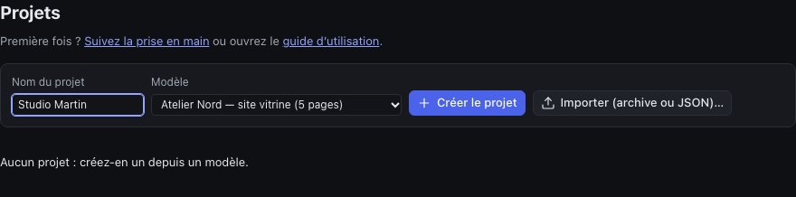
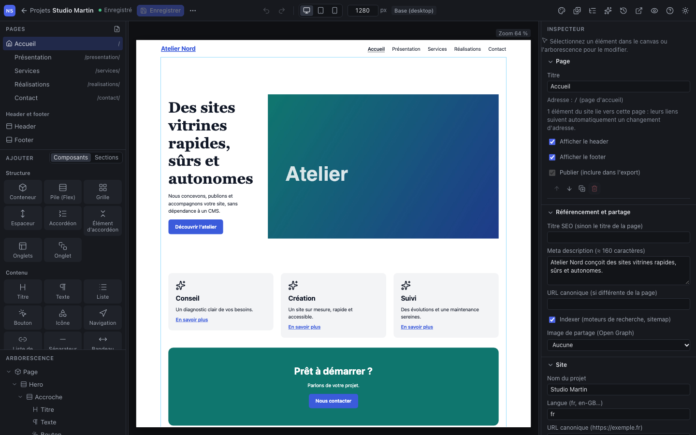
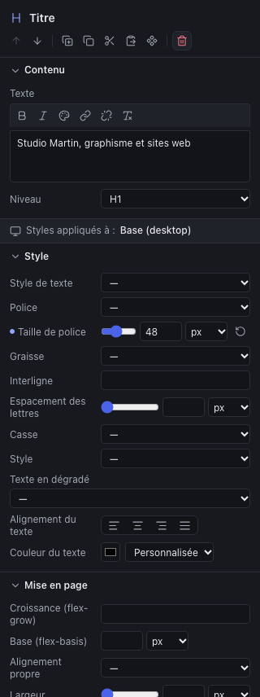
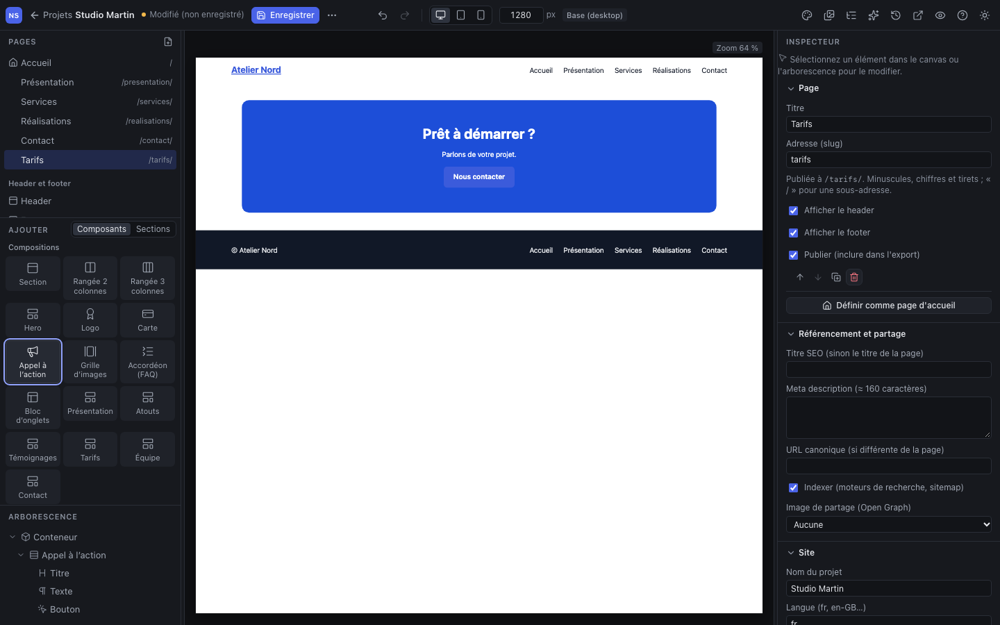
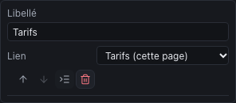
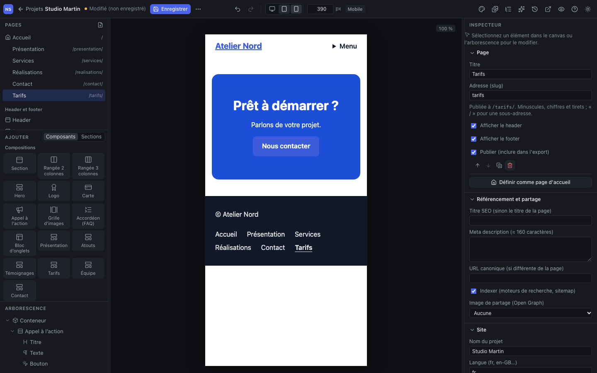
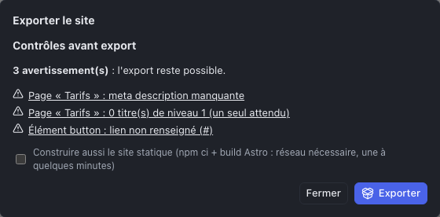

Dans ce tutoriel, vous partez du modèle « Atelier Nord », un site vitrine de cinq pages. Vous allez personnaliser l’accueil, ajouter une page « Tarifs » au site et au menu, vérifier l’affichage sur mobile, puis exporter le site.

> Rien de ce que vous faites ici n’est publié : le Studio est un atelier. Vous pourrez supprimer ce projet d’essai à la fin.

## Étape 1 : créer le projet

Ouvrez le Studio. L’écran **Projets** liste les sites de l’équipe.

1. Dans **Nom du projet**, saisissez par exemple « Studio Martin ».
2. Dans **Modèle**, choisissez **Atelier Nord — site vitrine (5 pages)**, dans le groupe « Sites complets ».
3. Cliquez sur **Créer le projet**.

Les autres modèles, sous « Pages de départ », créent un site d’une seule page : utiles pour partir de zéro, moins pour découvrir.

## Étape 2 : découvrir l’éditeur

Le projet s’ouvre sur la page d’accueil.

- **À gauche**, de haut en bas : les **pages** du site, la bibliothèque **Ajouter** (les éléments à insérer) et l’**arborescence** de la page.
- **Au centre**, le **canvas** : la page telle qu’elle sera publiée.
- **À droite**, l’**inspecteur**. Quand rien n’est sélectionné, il affiche les réglages de la page et du site.
- **En haut**, la barre d’outils : enregistrer, annuler, taille d’écran, et les panneaux du site (design system, médiathèque, menus…).

Le chapitre [L’interface](02-interface.md) détaille chaque zone.

## Étape 3 : modifier le titre de l’accueil

1. Dans le canvas, cliquez sur le grand titre « Des sites vitrines rapides, sûrs et autonomes ». Il s’entoure d’un cadre et sa ligne s’allume dans l’arborescence.
2. Dans l’inspecteur, section **Contenu**, remplacez le **Texte** par « Studio Martin, graphisme et sites web ».
3. Cliquez ailleurs ou appuyez sur <kbd>Tab</kbd> : le canvas se met à jour.

Sous le contenu, les sections **Style**, **Mise en page** et **Espacements** règlent l’apparence de l’élément. Essayez la **Taille de police** : le curseur et le champ font la même chose.

> **Une erreur ?** <kbd>⌘</kbd> <kbd>Z</kbd> (<kbd>Ctrl</kbd> <kbd>Z</kbd> sous Windows) annule, <kbd>⇧</kbd> <kbd>⌘</kbd> <kbd>Z</kbd> rétablit. Les flèches de la barre d’outils font de même.

## Étape 4 : ajouter une page « Tarifs »

1. Dans le panneau **Pages**, cliquez sur l’icône **Ajouter une page** (la feuille avec un +). Une page « Nouvelle page » apparaît et s’ouvre.
2. L’inspecteur montre ses réglages. Saisissez le **Titre** « Tarifs », puis l’**Adresse (slug)** « tarifs » : la page sera publiée à `/tarifs/`.
3. La page est vide, à l’exception du header et du footer communs à tout le site. Dans **Ajouter**, onglet **Composants**, descendez jusqu’aux **Compositions** et cliquez sur **Appel à l’action**. La section s’insère dans la page.

Vous pouvez aussi **glisser** un élément de la bibliothèque à l’endroit voulu du canvas : un repère indique où il sera déposé, et le Studio refuse les emplacements impossibles.

## Étape 5 : ajouter la page au menu

Une nouvelle page n’apparaît pas d’elle-même dans la navigation : c’est vous qui décidez.

1. Dans la barre d’outils, cliquez sur **Menus** (l’icône de liste, à droite).
2. Sous **Menu principal**, cliquez sur **Ajouter une entrée** (en bas de la liste).
3. Dans la nouvelle entrée, saisissez le **Libellé** « Tarifs » et choisissez la page « Tarifs » dans **Lien**.

Le lien apparaît aussitôt dans le header du canvas. Le lien suit la page : si vous changez plus tard son adresse, le menu reste juste. Cliquez de nouveau sur **Menus** pour revenir à l’inspecteur.

## Étape 6 : vérifier sur mobile

Dans la barre d’outils, cliquez sur l’icône **Mobile** (le téléphone). Le canvas prend la largeur d’un téléphone (390 px) : la navigation se replie derrière un bouton « Menu ». Sur l’accueil, les colonnes du hero et des cartes s’empilent.

Tant que vous êtes en mobile, les styles que vous modifiez ne s’appliquent **qu’au mobile** : l’indication « Styles appliqués à : Mobile » le rappelle dans l’inspecteur. C’est l’équivalent du mode responsive d’Elementor. Revenez en **Desktop** avant de continuer.

## Étape 7 : enregistrer

Cliquez sur **Enregistrer** en haut à gauche, ou appuyez sur <kbd>⌘</kbd> <kbd>S</kbd>. L’état passe de « Modifié (non enregistré) » à « Enregistré ».

> Le Studio n’enregistre pas automatiquement. Il vous prévient si vous fermez l’onglet avec des modifications non enregistrées.

## Étape 8 : exporter le site

1. Ouvrez le menu **⋯** (Plus d’actions), à côté du bouton Enregistrer, et choisissez **Exporter le site (Astro)…**.
2. Le Studio commence par des **contrôles avant export**.

Les **avertissements** n’empêchent pas d’exporter, mais ils méritent votre attention. Cliquez sur l’un d’eux pour aller directement à l’élément concerné. Ici :

- la page Tarifs n’a pas de **meta description** : quand rien n’est sélectionné, la section **Référencement et partage** de l’inspecteur la propose ;
- elle n’a pas de **titre de niveau 1** : sélectionnez le titre « Prêt à démarrer ? » et passez son **Niveau** à H1 (chaque page doit en avoir un, pour le référencement et l’accessibilité) ;
- le **bouton** ne mène nulle part : sélectionnez-le et choisissez la page « Contact » dans son **Lien**.

Les **erreurs bloquantes**, elles, doivent être corrigées avant l’export (une page liée qui n’existe plus, par exemple).

3. Cochez **Construire aussi le site statique**, puis cliquez sur **Exporter**. Comptez une à quelques minutes.
4. Deux liens **Télécharger (.tar.gz)** apparaissent :
   - les **sources Astro**, pour un développeur qui voudrait reprendre le site ;
   - le **site statique**, les fichiers HTML, CSS et images prêts à déposer chez un hébergeur.

Le chapitre [Publier et livrer](11-publier-et-livrer.md) explique la mise en ligne.

## Bravo

Vous avez créé un site, modifié une page, ajouté une page au menu, vérifié le mobile et exporté le tout. Pour faire le ménage, revenez aux **Projets** (flèche en haut à gauche) et supprimez le projet avec l’icône de corbeille.

Pour la suite :

- [L’interface](02-interface.md), pour connaître chaque zone et les raccourcis ;
- [Construire une page](03-construire-une-page.md), pour bâtir vos propres mises en page ;
- [les correspondances avec Tatsu et Elementor](annexe-a-correspondances.md), pour retrouver vos habitudes.
