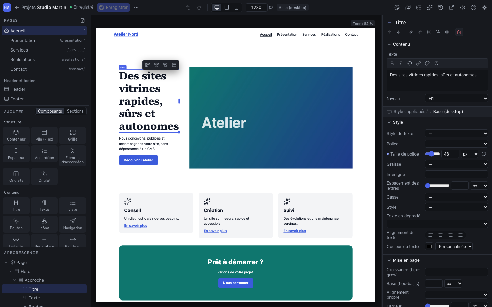

The editor is divided into five areas. The left and right panels are resized by dragging their edge; the Studio remembers their width.

## The Projects screen

This is the Studio's home page. There you create a project from a **template**, open, **duplicate** or **delete** an existing project (it is moved to the server's trash), and **import** an archive exported from another Studio. The site templates you have saved appear under "My site templates".

From the editor, the **← Projects** link at the top left brings you back. The **language** button (top right) chooses the interface language; the page reloads in the chosen language. On the first visit, the Studio opens in the browser's language if it knows it (English or French), else in English; the choice made afterwards is remembered by the browser.

## The toolbar

**On the left**, the project:

- the **project name** and its **status**: "Saved" or "Modified (not saved)";
- **Save** (<kbd>⌘</kbd> <kbd>S</kbd>);
- the **⋯** menu (More actions): export the site, export the project archive (site and media, to back it up or transfer it), save the project as a site template.

**In the middle**, the display:

- **Undo** and **Redo**;
- the **screen size**: Desktop (1280 px), Tablet (820 px), Mobile (390 px), or a precise width in the "px" field;
- the **edited breakpoint**, for instance "Base (desktop)" or "Mobile": the styles you change apply to this breakpoint (see below).

**On the right**, the site panels, which take the inspector's place (a second click brings it back):

| Icon | Panel | Role |
|---|---|---|
| Palette | **Design system** | Colors, sizes, fonts, text styles and project CSS |
| Images | **Media library** | Images, SVG and files of the project |
| List | **Menus** | Navigation menus |
| Sparkles | **AI assistant** | Proposed changes, to approve |
| Clock | **Operation log** | What was done during the session, by you or by the AI |

Then:

- **Site preview** opens the site in a new tab, to browse from page to page without the editing tools;
- **Preview** (the eye) hides the panels and selection frames, to judge the page alone;
- **?** opens this guide;
- the sun or the moon switches the interface to a **light or dark theme** (the produced site is not affected);
- the **language** button chooses the interface language (English or French). Save first: the page reloads. The language of the produced site is set separately, in the site settings (inspector, Site section).

## On the left: pages, library, layers

**Pages.** The list of pages, with their address; the house marks the home page, a crossed-out eye an unpublished page. Click a page to open it, the icon at the top right to add one. Below, **Header and footer** opens the parts shared by every page, and **Shared components** the project's reusable components, when there are any.

**Add.** The library, in two tabs:

- **Components**: the basic elements, sorted into **Layout** (container, stack, grid, spacer, accordion, tabs), **Content** (heading, text, list, button, icon, divider, navigation, link list), **Media** (image, video), then ready-made **Compositions** (section, rows of columns, hero, card, gallery, pricing, testimonials…);
- **Sections**: the sections of the library and those you have saved.

A click inserts the element into the selected box, or after the selected element, or at the end of the page if nothing is selected (details in the chapter [Building a page](03-building-a-page.md)). You can also drag it into the canvas.

**Layers.** The structure of the page, nesting included. It is used to select an element that is hard to reach in the canvas (a container without a background, an element hidden on mobile), to expand or collapse a part of the page, and to move elements by drag and drop. The **name** of an element is changed in the inspector, **Advanced** section: name your sections ("Hero", "Pricing"), the page becomes more readable.

## In the middle: the canvas

The canvas shows the page with the same components and styles as the exported site: what you see is what will be published. When the chosen width exceeds the available room, the page is scaled down ("Zoom 64%" at the top right).

- **Hovering** an element outlines it with a thin line; **clicking** selects it. Its type shows as a label above it.
- A selected element has **handles** to set its width and height with the mouse, and a small bar to **align it in its parent**.
- Links and buttons do not react to clicks in the canvas: use **Site preview** to navigate.

## On the right: the inspector

**When nothing is selected** (<kbd>Esc</kbd>), it sets the page and the site: title and address of the page, display of the header and footer, publication, **Search and sharing**, then name, language and URL of the site.

**When an element is selected**, it shows, from top to bottom:

1. the element's type and its **actions**: move up, move down, duplicate, copy, cut, paste, create a reusable component, delete;
2. **Content**: what the element contains (text, link, image, heading level…);
3. the **Styles applied to** indication: the breakpoint you are editing;
4. the styles, grouped into **Style**, **Layout**, **Spacing**, **Position and effects** and **Advanced**; only the settings useful to the element's type appear;
5. **Animations**.

### Breakpoints: desktop first, then the exceptions

The styles set in **Desktop** form the **base**: they apply to every screen size. In Tablet or Mobile, you only set the **differences** (a smaller heading size, a row that becomes a column). The provided templates define two breakpoints:

- **Tablet**, up to 1023 px wide;
- **Mobile**, up to 767 px.

Next to each setting, a **dot** shows where the value comes from: **filled**, it is set at this breakpoint; **hollow**, it is inherited from a larger size. The circular arrow to the right of a set value **resets** it, that is, goes back to the inherited value. The chapter [Styling and responsive design](04-styling-and-responsive.md) details the method.

## Keyboard shortcuts

On Windows and Linux, replace <kbd>⌘</kbd> with <kbd>Ctrl</kbd>.

| Action | Shortcut |
|---|---|
| Save | <kbd>⌘</kbd> <kbd>S</kbd> |
| Undo | <kbd>⌘</kbd> <kbd>Z</kbd> |
| Redo | <kbd>⇧</kbd> <kbd>⌘</kbd> <kbd>Z</kbd> or <kbd>⌘</kbd> <kbd>Y</kbd> |
| Copy, cut, paste the element | <kbd>⌘</kbd> <kbd>C</kbd>, <kbd>⌘</kbd> <kbd>X</kbd>, <kbd>⌘</kbd> <kbd>V</kbd> |
| Duplicate the element | <kbd>⌘</kbd> <kbd>D</kbd> |
| Delete the element | <kbd>Del</kbd> or <kbd>⌫</kbd> |
| Deselect | <kbd>Esc</kbd> |
| Edit a text on the page | Double-click the text (Heading, Text, Button, List, accordion title, tab label), or <kbd>F2</kbd> on the selected element (<kbd>Enter</kbd> too, from the canvas or on its row in the layers) |
| Validate / cancel the edit on the page | Click elsewhere (or <kbd>Enter</kbd>, except in a Text and a List) / <kbd>Esc</kbd> |
| Move the element one rank | <kbd>⌥</kbd> <kbd>↑</kbd> / <kbd>⌥</kbd> <kbd>↓</kbd> (<kbd>Alt</kbd> on Windows and Linux) |

In the layers, the arrows <kbd>↑</kbd> <kbd>↓</kbd> move from one element to another, <kbd>→</kbd> and <kbd>←</kbd> expand and collapse, <kbd>Home</kbd> and <kbd>End</kbd> go to the first and last element.

Editing shortcuts are inactive while typing in a field: <kbd>⌘</kbd> <kbd>Z</kbd> undoes the typing there, not the Studio's last action.

> **Copy and paste.** The Studio's clipboard is internal to the tab: you copy an element of one page to paste it on another page of the same project, but not into another program or another project. Saved sections are also specific to a project; to start again from a whole project, save it as a site template (chapter [Reuse](08-reuse.md)).
