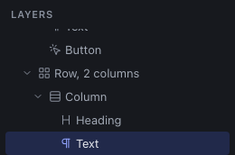
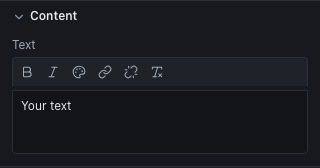

A Studio page is a tree: **containers** that contain other containers, and at the end of the branches **content components** (headings, texts, images, buttons…). This chapter explains how to build this tree; the next one, how to style it.

## Think in boxes, not in Section > Row > Column

Tatsu and Elementor impose a fixed hierarchy: a section contains rows, which contain columns, which contain modules. The Studio imposes nothing: you nest three kinds of boxes, as many times as needed.

| Box | Used to | CSS equivalent |
|---|---|---|
| **Container** | Group and delimit: a page section, an area with a background, a maximum width | A block (`<section>`, `
`…) |
| **Stack (Flex)** | Align elements **in a row or a column**: a heading and its text, buttons side by side, a visual to the right of a text | Flexbox |
| **Grid** | Spread elements over **equal columns**: cards, gallery, logos | CSS Grid |

Here are a few guidelines to help you choose:

- elements **one below the other** with regular spacing: a **stack** in a column;
- elements **side by side** of different sizes (a wide text, a narrow visual): a **stack** in a row;
- elements **of the same width** that wrap: a **grid**;
- a page **section** with its margins and maximum width: a **container**, or better the **Section** composition.

The **Container** also offers an **HTML tag** (`section`, `div`, `article`, `aside`…): it changes nothing to the display, but helps search engines and screen readers understand the page. A page section is tagged `<section>`, a decorative block `
`.

## Compositions: ready-made structures

Rather than nesting boxes by hand, start from the **Compositions**, at the bottom of the **Components** tab of the library. They are structures already set up, responsive included:

| Composition | Content | On mobile |
|---|---|---|
| **Section** | A centered container, 1120 px wide, inner margins | Reduced margins |
| **Row, 2 columns** | A grid of two columns (stacks) | One column |
| **Row, 3 columns** | A grid of three columns | Two on tablet, one on mobile |
| **Hero** | Heading, text and button, with a visual next to them | The visual goes below |
| **Card**, **Logo**, **Call to action**, **Image grid**, **Accordion (FAQ)**, **Tab block**, **About**, **Features**, **Testimonials**, **Pricing**, **Team**, **Contact** | Complete sections, to customize | Adapted |

Once inserted, a composition is an ordinary set of boxes and components: you can change, add or delete anything. Its text is written in the site's language. The **Sections** tab of the library offers other sections and those you have saved (chapter [Reuse](08-reuse.md)).

## Adding an element

**With a click.** A click on an element of the library inserts it:

- **into** the selected element, if it is a box that can contain it (it goes at the end);
- otherwise **right after** the selected element;
- otherwise, if nothing is selected, **at the end of the page**.

It is the most precise method: select a column, click **Heading** then **Text**, both are added to the column, one below the other.

**By drag and drop.** Drag an element of the library into the canvas: a marker shows where it will be dropped. Above an impossible place, the label says "cannot drop here".

Some boxes only accept specific children: an **Accordion** only contains **Accordion items**, **Tabs** only **Tab** items. Content components (heading, text, button, image…) contain nothing.

## Selecting

- **In the canvas**, click the element. To reach the box around it, use the layers: a click on a text selects the text, never its column.
- **In the layers**, click the row. It is the only way to reach a box without a background or margin, or an element hidden at the displayed breakpoint.
- <kbd>Esc</kbd> deselects: the inspector returns to the page settings.

Give your boxes a **name** (inspector, **Advanced** section, "Name in the layers"): "Column" repeated ten times says nothing, "Pro plan" does.

## Moving, duplicating, deleting

| To | Do |
|---|---|
| Change the order within the same box | **Move up** / **Move down** arrows at the top of the inspector, or <kbd>⌥</kbd> <kbd>↑</kbd> / <kbd>⌥</kbd> <kbd>↓</kbd> |
| Move elsewhere in the page | **Grab the element in the canvas** and drag it: a blue line shows where it will land, the original element is dimmed, <kbd>Esc</kbd> cancels; near the top or bottom edge of the canvas, the page scrolls by itself. Or drag its row in the **layers**; or **cut** (<kbd>⌘</kbd> <kbd>X</kbd>), select the destination, **paste** (<kbd>⌘</kbd> <kbd>V</kbd>) |
| Move to another page | Cut, open the other page, select the destination, paste |
| Duplicate | <kbd>⌘</kbd> <kbd>D</kbd>, or the **Duplicate** icon of the inspector: the copy goes right after |
| Delete | <kbd>Del</kbd>, or the red trash of the inspector |

In the canvas, the **selected** element moves if you grab it from the inside (to move a whole box, select it first, for instance in the layers); otherwise, the element under the pointer moves. An element of a reusable component takes the whole component with it. A move changes the order and the containing box, never a pixel position.

Pasting follows the same rule as a click in the library: into the selected box, otherwise after the selected element.

> Any action is undone with <kbd>⌘</kbd> <kbd>Z</kbd>, including a deletion or a paste.

## Content components

| Component | Content settings | Good to know |
|---|---|---|
| **Heading** | Rich text (bold, italic, color, link, line breaks), **Level** (H1 to H6) | The level is the document's structure, not the size: a single H1 per page, then H2 for sections, H3 below. The size is set in the style. |
| **Text** | Rich text | One or several paragraphs; bold, italic, color, links and line breaks. |
| **Marquee** | **Content** (texts or images), **Texts**, **Separator**, **Images**, **Image height**, **Spacing**, **Duration of one loop**, **Direction** | Scrolls in a loop, stops on hover and focus, with a **Pause** button. Still for visitors who reduced animations. |
| **List** | **Bullets** (disc, circle, square, none, numbers, letters, Roman numerals), **Items** | A real HTML list: each item is a line of rich text (bold, italic, links). Numbers, letters and Roman numerals make it an ordered list. |
| **Button** | Label, Link, **Appearance** (Primary, Secondary, Text link, Plain link) | **Plain link** has no underline and takes the surrounding color: for a logo, as in the header. The link leads to a page of the site, an address (URL, `mailto:`, `tel:`) or a file of the media library. |
| **Image** | Image, **Alternative text**, caption, link, fit, loading | Describe the image in the alternative text, or tick **Decorative image** if it adds nothing to the meaning. Chapter [Media](07-media.md). |
| **Gallery** | **Images** (alternative text and caption of each), **Layout** (masonry or tiles), **Tile ratio**, **Enlarge on click** | See the chapter [Media](07-media.md). Columns and spacing are set in the **Layout** section, per screen size. |
| **Carousel** | **Images**, **Accessible name**, **Image ratio**, **Visible images** (per screen size), **Spacing**, **Autoplay** and **Interval** | See the chapter [Media](07-media.md). |
| **Video** | YouTube or Vimeo address, title | No hosted video file. |
| **Icon** | Pictogram, **Accessible name** | Empty name: the icon is decorative. |
| **Divider** | — | A horizontal line. |
| **Spacer** | — | An empty space of adjustable height. Prefer the **Spacing (gap)** of stacks and grids, easier to maintain. |
| **Navigation** | Menu, label of the mobile button, **Collapse into a button** (on mobile, on tablet and mobile, never) | Shows a menu of the **Menus** panel. |
| **Link list** | Menu, layout (in a column, in a row) | A menu without a collapse button, for a footer for instance. |
| **Accordion** | — | Each **Accordion item** has a title and free content. Tick **Open on load** to edit it in the canvas. |
| **Tabs** | Accessible name | Each **Tab** has a title and free content. |

### Editing a text directly on the page

**Double-click** a **Heading**, a **Text**, a **Button**, a **List**, the title of an **Accordion item** or the label of a **Tab** in the canvas: the text becomes editable in place, with its real font and layout. The selection frame becomes dashed, marked "editing". <kbd>F2</kbd> does the same on the selected element (and <kbd>Enter</kbd>, from the canvas or on its row in the layers).

- Type your text; <kbd>⌘</kbd> <kbd>B</kbd> and <kbd>⌘</kbd> <kbd>I</kbd> set bold and italic (Heading, Text, List).
- In a **Text**, <kbd>Enter</kbd> starts a new paragraph and <kbd>⇧</kbd> <kbd>Enter</kbd> inserts a line break. In a **Heading**, <kbd>Enter</kbd> validates and <kbd>⇧</kbd> <kbd>Enter</kbd> inserts a line break. In a **List**, the whole list is edited: <kbd>Enter</kbd> creates the next item, <kbd>⌫</kbd> at the start of an item merges it with the previous one, and an emptied item disappears. In a **Button**, an accordion title or a tab label, <kbd>Enter</kbd> validates.
- **Click elsewhere** (or press <kbd>Enter</kbd> where it validates, see above) to validate; <kbd>Esc</kbd> cancels and restores the previous text.
- The whole input counts as **a single** step: <kbd>⌘</kbd> <kbd>Z</kbd> after validation undoes it at once. While typing, <kbd>⌘</kbd> <kbd>Z</kbd> and <kbd>Del</kbd> act in the text, never on the element.
- Pasted text arrives **without its formatting**.
- In a **reusable component**, only the texts exposed as parameters are edited in place, as a value of this copy. For the others, edit the component itself.

While typing in a Heading, a Text or a List, a **formatting toolbar** floats above the text (below it when it is at the top of the page): **bold**, **italic**, **color**, **link**, **remove link** and **clear formatting**. Select words, then click the button: typing goes on. These buttons work like the inspector's, described below.

### Rich text

The **Text** field has a small toolbar: **bold** (<kbd>⌘</kbd> <kbd>B</kbd>), **italic** (<kbd>⌘</kbd> <kbd>I</kbd>), **color**, **link**, **remove link** and **clear formatting**. Select words, then click the wanted button.

- **Link** opens a small form: choose a **site page** (the link then follows its address changes), a **file to download** from the media library, or type an **address** (https, http, mailto, tel or #anchor; a page address such as `/about/` becomes a link to that page). **Apply** sets the link, <kbd>Esc</kbd> or **Cancel** closes the form.

- In a **Text**, <kbd>Enter</kbd> starts a **new paragraph** and <kbd>⇧</kbd> <kbd>Enter</kbd> inserts a **line break**.
- In a **Heading**, <kbd>Enter</kbd> inserts a line break (a heading stays a single block).
- **Color** opens the colors of the design system and a swatch picker (**Other**). The chosen color is recorded as is: if you later change a color of the design system, the passages already colored do not follow. To color a whole element, prefer the inspector's **Text color**, which accepts design system colors.

For an enumeration, use the **List** component: in the inspector, each item has its own rich field, with arrows to move it, a trash icon to delete it and **Add an item** at the bottom. Subheadings inside a text are not available: use a **Heading** component between two **Text**s, which keeps the heading hierarchy right.

## Good habits

- **Start with the structure**, then the content, then the styling. A page well divided into named sections changes in a few clicks; a page of anonymous boxes quickly becomes a maze.
- **One section = one container** (or the Section composition), with the `<section>` tag.
- **Headings in order**: H1, then H2, then H3, without skipping a level. The export reports a page without an H1.
- **No empty boxes to make room**: set the spacing instead (next chapter).
