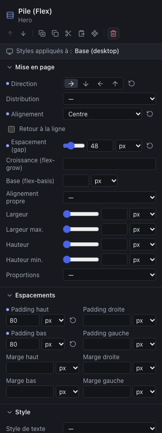
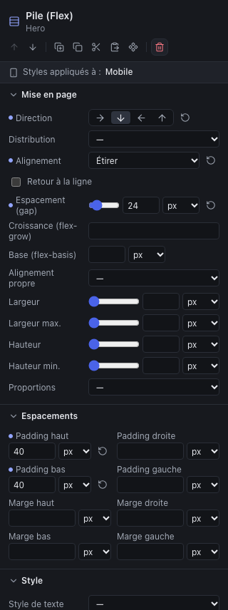

L’inspecteur regroupe les styles en cinq sections. Seuls les réglages utiles au type d’élément apparaissent : un titre n’a pas de « Direction », une pile n’a pas de « Police ».

| Section | Contient |
|---|---|
| **Style** | Style de texte, police, taille, graisse, interligne, espacement des lettres, casse, italique, alignement, couleur du texte ; couleur de fond, dégradé, image de fond, arrondi, bordure, ombre ; cadrage de l’image |
| **Mise en page** | Pour une pile : direction, distribution, alignement, retour à la ligne, espacement. Pour une grille : colonnes, espacement, alignement. Pour tout élément : comportement dans son parent et dimensions |
| **Espacements** | Padding (marge intérieure) et marge (extérieure), côté par côté |
| **Position et effets** | Position, décalage, plan, débordement, rotation, échelle |
| **Avancé** | Masquer sur ce breakpoint ; nom dans l’arborescence ; **Classes CSS** pour la feuille du projet (chapitre [Design system](05-design-system.md)) |

Pour les composants de contenu (titre, texte, bouton…), **Style** vient en premier ; pour les boîtes, **Mise en page**.

Les boîtes (conteneur, pile, grille) ont aussi les réglages de texte (couleur, police, taille, alignement) : ils s’appliquent à **tout leur contenu**, sauf aux éléments qui ont leur propre réglage. C’est le moyen le plus simple de passer une section entière en texte clair sur fond sombre.

## Les valeurs et les unités

Les dimensions s’écrivent avec une **unité** choisie à côté du champ :

| Unité | Signifie | Usage conseillé |
|---|---|---|
| `px` | Pixels | Espacements, bordures arrondies, tailles fixes |
| `rem` | Multiple de la taille de texte du navigateur (16 px par défaut) | Tailles de police respectueuses des réglages du visiteur |
| `em` | Multiple de la taille de texte de l’élément | Espacements proportionnels au texte |
| `%` | Pourcentage du parent | Largeurs |
| `vw`, `vh` | Pourcentage de la largeur ou de la hauteur de l’écran | Hauteur d’un hero plein écran |

Certains champs acceptent `auto` (largeur, hauteur, marges). Une marge gauche et droite à `auto` centre un élément de largeur limitée.

Le **curseur** et le **champ** font la même chose ; un glissement de curseur compte pour une seule action à annuler. Les listes déroulantes proposent aussi les **tokens** du design system (chapitre suivant) : une taille ou une couleur nommée, partagée par tout le site.

Un champ **vide** n’impose rien : l’élément garde son comportement par défaut ou la valeur héritée.

## Couleurs

Chaque couleur se règle de deux façons :

- avec le **nuancier** (le carré coloré) : une couleur **personnalisée**, propre à cet élément ;
- avec la **liste** à côté : une couleur du **design system** (« Primaire »…). Si la couleur change dans le design system, tous les éléments qui l’utilisent suivent.

Préférez les couleurs du design system : c’est le moyen de garder une charte cohérente et modifiable en un geste.

## Typographie fine

Dans la section **Style** des textes, titres, boutons, listes et boîtes :

| Réglage | Usage |
|---|---|
| **Espacement des lettres** | Espacer les capitales d’un surtitre (2 à 5 px), resserrer un très grand titre (valeur négative, −1 ou −2 px) |
| **Casse** | **CAPITALES**, **minuscules**, **Initiales En Capitales** : le texte reste saisi normalement (lisible par les lecteurs d’écran et les moteurs), seul l’affichage change |
| **Style** | **Italique** pour tout l’élément ; pour quelques mots, utilisez l’italique du texte enrichi |
| **Texte en dégradé** | Remplit les lettres d’un dégradé (même réglage que le dégradé de fond) ; **Aucun** le retire, par exemple sur mobile. À réserver aux grands titres, et à vérifier en contraste sur toute la longueur |

Ces réglages existent aussi dans les **styles de texte** du design system, pour les appliquer à tout le site.

## Bordures et ombres

Dans la section **Style** des boîtes, des boutons, des images et des séparateurs :

| Réglage | Effet |
|---|---|
| **Bordure** | L’épaisseur du trait, sur les quatre côtés. Régler une épaisseur choisit aussi un trait plein si aucun style n’est défini |
| **Style de bordure** | Plein, tirets, pointillés, double, ou aucune (pour retirer une bordure héritée sur mobile, par exemple) |
| **Couleur de bordure** | Une couleur personnalisée ou du design system |
| **Ombre** | **Douce**, **Moyenne**, **Forte**, ou **Personnalisée** : décalage X et Y, flou, étendue, couleur, opacité, ombre intérieure. **Aucune** retire une ombre héritée |

Une ombre discrète (douce ou moyenne) suffit presque toujours à détacher une carte du fond ; une ombre forte attire l’œil, à réserver à un élément. Combinez une bordure avec l’**Arrondi** pour des cartes ou des boutons « contour ».

## Dégradés et images de fond

Toujours dans la section **Style** :

- **Dégradé** : **Linéaire** (avec un **angle** : 180° va de haut en bas, 90° de gauche à droite), **Radial** (du centre vers les bords), ou le préréglage **Voile sombre (sur une image)**. Chaque couleur a une **opacité** et une **position** de 0 à 100 % ; de 2 à 4 couleurs. **Aucun** retire un dégradé hérité.
- **Image de fond** : une image de la **médiathèque** (importez-la d’abord), avec un **ajustement** (**Couvrir** remplit la boîte quitte à recadrer, **Contenir** montre l’image entière, **Taille d’origine**) et une **position** (centre, haut, bas, gauche, droite). **Aucune** retire une image héritée.

Le dégradé se dessine **par-dessus** l’image : c’est ainsi qu’on assombrit une photo de hero pour y poser un titre blanc. La couleur de fond reste dessous, visible pendant le chargement de l’image.

Une image de fond est **décorative** : elle n’a pas de texte alternatif et les lecteurs d’écran l’ignorent. Une image qui porte du sens (une photo de produit, un schéma) se place avec un composant **Image**. Et le texte posé dessus doit rester lisible partout : vérifiez-le en Mobile, où le recadrage change, et forcez le voile plutôt que de compter sur une zone sombre de la photo.

> **Poids.** Contrairement au composant Image, une image de fond est publiée **telle quelle**, sans conversion ni versions réduites. Préparez-la : 1920 px de large au plus, en JPEG ou WebP compressé, sous 500 Ko. L’export vous avertit au-delà.

## La pile (Flexbox), en pratique

| Réglage | Effet |
|---|---|
| **Direction** | **Ligne** (côte à côte) ou **Colonne** (les uns sous les autres) ; les deux autres inversent l’ordre |
| **Distribution** | Répartition **dans le sens de la direction** : début, centre, fin, ou espacé (entre, autour, égal) |
| **Alignement** | Placement **dans l’autre sens** : étirer (même hauteur en ligne), début, centre, fin, ligne de base |
| **Retour à la ligne** | Les éléments trop larges passent à la ligne suivante au lieu de se serrer |
| **Espacement (gap)** | L’écart entre les éléments, sans marge à régler sur chacun |

Les éléments **à l’intérieur** d’une pile ont trois réglages en plus, dans leur propre section **Mise en page** :

| Réglage | Effet |
|---|---|
| **Croissance (flex-grow)** | Part de la place restante que prend l’élément. Deux colonnes à 2 et 1 : la première est deux fois plus large |
| **Base (flex-basis)** | Largeur de départ, avant partage de la place restante. `30 %` donne une colonne d’environ un tiers |
| **Alignement propre** | Remplace l’alignement de la pile pour cet élément seul |

> **Des colonnes de largeurs différentes** (deux tiers / un tiers) : une **pile en ligne**, avec une **Croissance** de 2 sur la première colonne et de 1 sur la seconde. La grille, elle, fait des colonnes égales.

## La grille, en pratique

Une grille a peu de réglages : le nombre de **Colonnes** (1 à 12), l’**Espacement (gap)** entre les cases, et l’**Alignement** vertical du contenu des cases. Les éléments remplissent les cases dans l’ordre, de gauche à droite puis ligne par ligne. Réduisez le nombre de colonnes sur tablette et mobile : c’est ce que font les compositions « Rangée ».

## Dimensions et espacements

- **Largeur**, **Largeur max.**, **Hauteur**, **Hauteur min.** : une section centrée prend une largeur max. (1120 px par exemple) et des marges gauche et droite à `auto`. Préférez **Hauteur min.** à **Hauteur** : le contenu peut grandir sans déborder.
- **Proportions** : impose un rapport (16:9, carré…) ; utile pour une image ou un bloc visuel.
- **Padding** : l’espace **à l’intérieur** de l’élément, entre son bord et son contenu (il prend la couleur de fond).
- **Marge** : l’espace **à l’extérieur**, avec ses voisins. Entre les éléments d’une pile ou d’une grille, préférez l’**Espacement (gap)** du parent.

## Manipuler à la souris

Un élément sélectionné dans le canvas porte des **poignées** :

- la poignée du **bord droit** règle la **largeur** ;
- celle du **bord bas** règle la **hauteur minimale** ;
- des **guides** apparaissent quand le bord s’aligne sur celui d’un voisin ou du parent, et l’élément s’y aimante.

Dans une pile ou une grille, une petite barre au-dessus de l’élément l’**aligne dans son parent** : début, centre, fin ou étirer (c’est l’**Alignement propre**).

Les poignées écrivent des valeurs en pixels sur le breakpoint affiché ; les champs de l’inspecteur restent le moyen le plus précis.

## Position et effets

- **Position** : **dans le flux** (par défaut), **relative** (sert de repère à ses enfants), **absolue** (placée par rapport au parent relatif le plus proche, avec Haut, Droite, Bas, Gauche), **collante** (voir ci-dessous). Réservez la position absolue aux décors : un élément absolu ne pousse plus ses voisins et peut les recouvrir sur mobile.
- **Collante** : l’élément défile normalement, puis reste visible quand il atteint le haut de l’écran (à la distance **Haut**, 0 par défaut), tant que sa boîte parente est visible. Pour un header qui reste en haut de page, rendez collante la boîte du header et donnez-lui une couleur de fond et un **Plan** élevé (100) ; pour une colonne qui accompagne le défilement d’une colonne voisine plus longue, rendez collante la colonne courte.
- **Plan (z-index)** : quel élément passe devant quand ils se chevauchent.
- **Débordement** : que faire du contenu qui dépasse : visible, masqué, rogné, défilement.
- **Décalage**, **Rotation**, **Échelle** : transforment l’affichage sans changer la place occupée.

## Le responsive

### Le principe : la base, puis les exceptions

Les modèles fournis ont trois tailles d’écran :

| Breakpoint | S’applique | Aperçu |
|---|---|---|
| **Base (desktop)** | À toutes les largeurs | 1280 px |
| **Tablette** | Jusqu’à 1023 px | 820 px |
| **Mobile** | Jusqu’à 767 px | 390 px |

Les réglages faits en **Desktop** s’appliquent **partout**. En **Tablette**, vous réglez seulement ce qui change sur tablette **et** mobile ; en **Mobile**, ce qui change sur mobile seul. Chaque taille hérite de la précédente : le mobile hérite de la tablette, qui hérite de la base.

Concevez donc d’abord pour le desktop, puis passez en tablette et en mobile pour corriger : passer une pile en colonne, réduire une taille de titre, diminuer des marges, réduire le nombre de colonnes d’une grille.

### Savoir où l’on est

- La barre d’outils affiche le **breakpoint édité** (« Base (desktop) », « Tablette », « Mobile ») ; l’inspecteur le rappelle : **Styles appliqués à : Mobile**.
- Devant chaque réglage, un **point plein** indique une valeur **définie sur ce breakpoint** ; un **point creux**, une valeur **héritée** d’une taille plus grande. Survolez le point pour le lire.
- La **flèche circulaire** à droite d’une valeur définie la **réinitialise** : l’élément reprend la valeur héritée.

Le champ « px » de la barre d’outils affiche n’importe quelle largeur (de 320 à 2560 px) : utile pour vérifier une taille intermédiaire, une petite tablette ou un grand écran. Les styles modifiés s’appliquent alors au breakpoint qui couvre cette largeur.

### Masquer un élément selon l’écran

Section **Avancé**, **Masquer sur ce breakpoint** : l’élément disparaît sur ce breakpoint et les plus petits. Pour afficher un élément **seulement** sur mobile, masquez-le en Desktop, puis décochez la case en Mobile.

Un élément masqué reste sélectionnable dans l’arborescence. N’en abusez pas : un contenu important doit exister sur toutes les tailles, et deux versions d’un même contenu sont deux fois plus longues à maintenir.

### Les vérifications avant de passer à la suite

- Parcourez chaque page en **Tablette** et en **Mobile**.
- Essayez une largeur intermédiaire (900 px, 600 px) avec le champ « px ».
- Utilisez **Aperçu du site** pour naviguer comme un visiteur, en rétrécissant la fenêtre du navigateur.

## Ce qui n’existe pas (encore)

Pas encore de bordure sur un seul côté, ni de plusieurs ombres ou images de fond sur un même élément. En attendant, intégrez les visuels comme des composants **Image** dans la mise en page (un hero texte + image côte à côte, par exemple) et signalez à l’équipe les effets qui vous manquent. Les breakpoints sont ceux des modèles : on ne peut pas encore en ajouter depuis l’interface.
