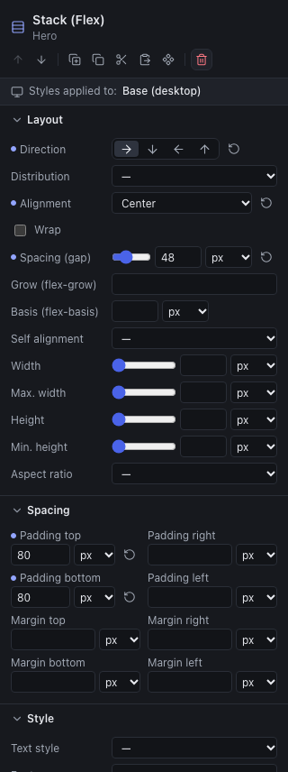
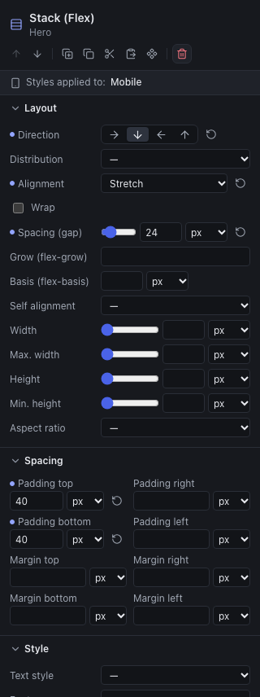

The inspector groups the styles into five sections. Only the settings useful to the element's type appear: a heading has no "Direction", a stack has no "Font".

| Section | Contains |
|---|---|
| **Style** | Text style, font, size, weight, line height, letter spacing, case, italics, alignment, text color; background color, gradient, background image, radius, border, shadow; image framing |
| **Layout** | For a stack: direction, distribution, alignment, wrap, spacing. For a grid: columns, spacing, alignment. For any element: behavior in its parent and dimensions |
| **Spacing** | Padding (inner margin) and margin (outer), side by side |
| **Position and effects** | Position, offset, layer, overflow, rotation, scale |
| **Advanced** | Hide on this breakpoint; name in the layers; **CSS classes** for the project stylesheet (chapter [Design system](05-design-system.md)) |

For content components (heading, text, button…), **Style** comes first; for boxes, **Layout**.

Boxes (container, stack, grid) also have the text settings (color, font, size, alignment): they apply to **all their content**, except to the elements that have their own setting. It is the simplest way to turn a whole section into light text on a dark background.

## Values and units

Dimensions are written with a **unit** chosen next to the field:

| Unit | Means | Advised use |
|---|---|---|
| `px` | Pixels | Spacing, rounded corners, fixed sizes |
| `rem` | Multiple of the browser's text size (16 px by default) | Font sizes that respect the visitor's settings |
| `em` | Multiple of the element's text size | Spacing proportional to the text |
| `%` | Percentage of the parent | Widths |
| `vw`, `vh` | Percentage of the screen's width or height | Height of a full-screen hero |

Some fields accept `auto` (width, height, margins). A left and right margin set to `auto` centers an element of limited width.

The **slider** and the **field** do the same thing; dragging a slider counts as a single action to undo. The drop-down lists also offer the **tokens** of the design system (next chapter): a named size or color, shared by the whole site.

An **empty** field imposes nothing: the element keeps its default behavior or the inherited value.

## Colors

Each color is set in two ways:

- with the **swatch** (the colored square): a **custom** color, specific to this element;
- with the **list** next to it: a color of the **design system** ("Primary"…). If the color changes in the design system, every element using it follows.

Prefer the colors of the design system: it is the way to keep consistent brand guidelines that change in one move.

## Fine typography

In the **Style** section of texts, headings, buttons, lists and boxes:

| Setting | Use |
|---|---|
| **Letter spacing** | Space out the capitals of an overline (2 to 5 px), tighten a very large heading (negative value, −1 or −2 px) |
| **Case** | **UPPERCASE**, **lowercase**, **Capitalized Words**: the text stays typed normally (readable by screen readers and search engines), only the display changes |
| **Style** | **Italic** for the whole element; for a few words, use the italics of the rich text |
| **Gradient text** | Fills the letters with a gradient (same setting as the background gradient); **None** removes it, for instance on mobile. Keep it for large headings, and check the contrast over the whole length |

These settings also exist in the **text styles** of the design system, to apply them to the whole site.

## Borders and shadows

In the **Style** section of boxes, buttons, images and dividers:

| Setting | Effect |
|---|---|
| **Border** | The width of the line, on all four sides. Setting a width also chooses a solid line if no style is set |
| **Border style** | Solid, dashed, dotted, double, or none (to remove an inherited border on mobile, for instance) |
| **Border color** | A custom or design system color |
| **Shadow** | **Soft**, **Medium**, **Strong**, or **Custom**: X and Y offset, blur, spread, color, opacity, inset shadow. **None** removes an inherited shadow |

A discreet shadow (soft or medium) is almost always enough to lift a card from the background; a strong shadow draws the eye, to keep for one element. Combine a border with the **Radius** for "outline" cards or buttons.

## Gradients and background images

Still in the **Style** section:

- **Gradient**: **Linear** (with an **angle**: 180° goes from top to bottom, 90° from left to right), **Radial** (from the center to the edges), or the **Dark veil (over an image)** preset. Each color has an **opacity** and a **position** from 0 to 100%; from 2 to 4 colors. **None** removes an inherited gradient.
- **Background image**: an image of the **media library** (import it first), with a **fit** (**Cover** fills the box even if it crops, **Contain** shows the whole image, **Original size**) and a **position** (center, top, bottom, left, right). **None** removes an inherited image.

The gradient is drawn **on top of** the image: that is how a hero photo is darkened to put a white heading on it. The background color stays below, visible while the image loads.

A background image is **decorative**: it has no alternative text and screen readers ignore it. An image that carries meaning (a product photo, a diagram) is placed with an **Image** component. And the text placed on top must stay readable everywhere: check it on Mobile, where the cropping changes, and strengthen the veil rather than counting on a dark area of the photo.

> **Weight.** Unlike the Image component, a background image is published **as is**, without conversion or reduced versions. Prepare it: 1920 px wide at most, as a compressed JPEG or WebP, under 500 KB. The export warns you above that.

## The stack (Flexbox), in practice

| Setting | Effect |
|---|---|
| **Direction** | **Row** (side by side) or **Column** (one below the other); the two others reverse the order |
| **Distribution** | Spreading **along the direction**: start, center, end, or spaced (between, around, evenly) |
| **Alignment** | Placement **in the other direction**: stretch (same height in a row), start, center, end, baseline |
| **Wrap** | Elements that are too wide go to the next line instead of squeezing |
| **Spacing (gap)** | The gap between the elements, without a margin to set on each |

The elements **inside** a stack have three more settings, in their own **Layout** section:

| Setting | Effect |
|---|---|
| **Grow (flex-grow)** | Share of the remaining room the element takes. Two columns at 2 and 1: the first is twice as wide |
| **Basis (flex-basis)** | Starting width, before the remaining room is shared. `30%` gives a column of about a third |
| **Self alignment** | Replaces the stack's alignment for this element alone |

> **Columns of different widths** (two thirds / one third): a **stack in a row**, with a **Grow** of 2 on the first column and 1 on the second. The grid makes equal columns.

## The grid, in practice

A grid has few settings: the number of **Columns** (1 to 12), the **Spacing (gap)** between the cells, and the vertical **Alignment** of the cells' content. Elements fill the cells in order, from left to right then row by row. Reduce the number of columns on tablet and mobile: that is what the "Row" compositions do.

## Dimensions and spacing

- **Width**, **Max. width**, **Height**, **Min. height**: a centered section takes a max. width (1120 px for instance) and left and right margins set to `auto`. Prefer **Min. height** to **Height**: the content can grow without overflowing.
- **Aspect ratio**: imposes a ratio (16:9, square…); useful for an image or a visual block.
- **Padding**: the space **inside** the element, between its edge and its content (it takes the background color).
- **Margin**: the space **outside**, with its neighbors. Between the elements of a stack or a grid, prefer the parent's **Spacing (gap)**.

## Working with the mouse

An element selected in the canvas has **handles**:

- the handle on the **right edge** sets the **width**;
- the one on the **bottom edge** sets the **minimum height**;
- **guides** appear when the edge lines up with that of a neighbor or of the parent, and the element snaps to them.

In a stack or a grid, a small bar above the element **aligns it in its parent**: start, center, end or stretch (that is the **Self alignment**).

The handles write values in pixels at the displayed breakpoint; the inspector's fields remain the most precise way.

## Position and effects

- **Position**: **In the flow** (the default), **Relative** (a reference for its children), **Absolute** (placed relative to the nearest relative parent, with Top, Right, Bottom, Left), **Sticky** (see below). Keep absolute positioning for decorations: an absolute element no longer pushes its neighbors and can cover them on mobile.
- **Sticky**: the element scrolls normally, then stays visible when it reaches the top of the screen (at the **Top** distance, 0 by default), as long as its parent box is visible. For a header that stays at the top of the page, make the header box sticky and give it a background color and a high **Layer** (100); for a column that follows the scrolling of a longer neighboring column, make the short column sticky.
- **Layer (z-index)**: which element goes in front when they overlap.
- **Overflow**: what to do with content that goes beyond: visible, hidden, clipped, scroll.
- **Offset**, **Rotation**, **Scale**: transform the display without changing the room taken.

## Responsive

### The principle: the base, then the exceptions

The provided templates have three screen sizes:

| Breakpoint | Applies | Preview |
|---|---|---|
| **Base (desktop)** | At every width | 1280 px |
| **Tablet** | Up to 1023 px | 820 px |
| **Mobile** | Up to 767 px | 390 px |

The settings made on **Desktop** apply **everywhere**. On **Tablet**, you only set what changes on tablet **and** mobile; on **Mobile**, what changes on mobile alone. Each size inherits from the previous one: mobile inherits from tablet, which inherits from the base.

So design for desktop first, then switch to tablet and mobile to correct: turn a stack into a column, reduce a heading size, decrease margins, reduce the number of columns of a grid.

### Knowing where you are

- The toolbar shows the **edited breakpoint** ("Base (desktop)", "Tablet", "Mobile"); the inspector repeats it: **Styles applied to: Mobile**.
- In front of each setting, a **filled dot** shows a value **set at this breakpoint**; a **hollow dot**, a value **inherited** from a larger size. Hover the dot to read it.
- The **circular arrow** to the right of a set value **resets** it: the element takes the inherited value back.

The "px" field of the toolbar shows any width (from 320 to 2560 px): useful to check an intermediate size, a small tablet or a large screen. The styles you change then apply to the breakpoint that covers this width.

### Hiding an element depending on the screen

**Advanced** section, **Hide on this breakpoint**: the element disappears at this breakpoint and the smaller ones. To show an element **only** on mobile, hide it on Desktop, then untick the box on Mobile.

A hidden element stays selectable in the layers. Do not overuse it: important content must exist at every size, and two versions of the same content take twice as long to maintain.

### Checks before moving on

- Go through each page on **Tablet** and **Mobile**.
- Try an intermediate width (900 px, 600 px) with the "px" field.
- Use **Site preview** to browse like a visitor, narrowing the browser window.

## What does not exist (yet)

No border on a single side yet, nor several shadows or background images on the same element. Meanwhile, integrate the visuals as **Image** components in the layout (a text + image hero side by side, for instance) and report the effects you miss. The breakpoints are those of the templates: they cannot be added from the interface yet.
