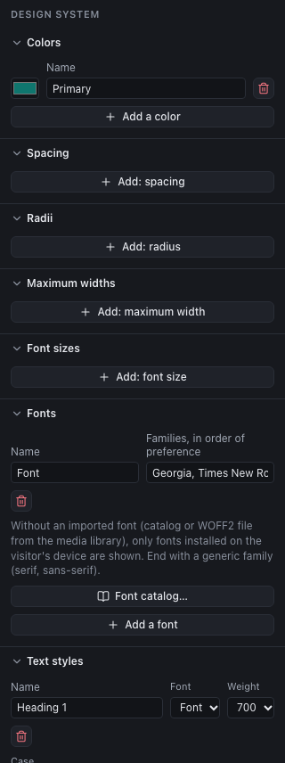
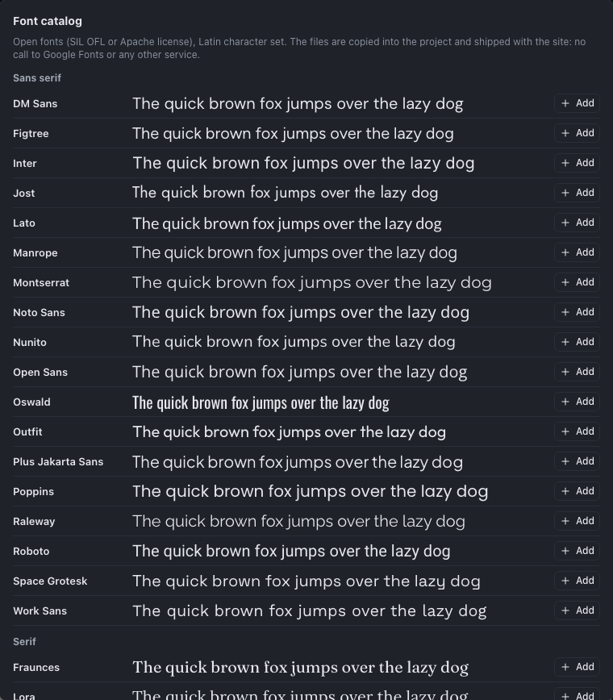

The design system gathers the site's **named values**: its colors, sizes, fonts and text styles. They are called **tokens**. It also holds the **project stylesheet**, for the effects the inspector does not offer. It is the equivalent of the global colors and typography of Elementor (Site Settings) or Tatsu.

An element that uses a token does not contain the value, but a reference: change the "Primary" color in the design system, and every button, background and text that uses it changes at once, on every page.

Open it with the **Design system** icon (the palette) of the toolbar. It takes the inspector's place; a second click on the icon brings the inspector back.



## Colors

Each color has a **swatch** and a **name**. Name colors by their **role** rather than their hue: "Primary", "Accent", "Text", "Light background" stay right the day the brand guidelines change, "Green" does not.

To use it, in an element's inspector, choose the color's name in the list next to the swatch (**Text color**, **Background color**).

> Check the **contrast** between text and background: at least 4.5:1 for body text (WCAG accessibility criterion). The Studio does not measure it yet; a tool such as WebAIM's *Contrast Checker* does it online.

## Sizes: spacing, radii, widths, font sizes

Four families of sizes:

| Family | For |
|---|---|
| **Spacing** | Paddings, margins, spacing (gap): "S", "M", "L", "Section"… |
| **Radii** | Radius of buttons, cards, images |
| **Maximum widths** | Width of the content: "Text" (700 px), "Page" (1120 px)… |
| **Font sizes** | Text sizes outside text styles |

A size has a **Base** value and, if needed, a value per **breakpoint** (Tablet, Mobile). A "Section" token at 80 px at the base and 40 px on mobile sets the spacing of every section on mobile at once, without touching the pages.

To use a size, in a dimension field of the inspector, open the list of **units**: the size tokens are there, in the **Tokens** group.

## Fonts

A design system font is a **list of families, in order of preference**, for instance `Lora, Georgia, serif`: the browser uses the first one it finds. For the site to show everywhere with the font of the brand guidelines, **import it**: its files are then delivered with the site.

### The font catalog

The **Font catalog…** button, under the **Fonts** section, offers 25 free fonts among the most used on the web: Inter, Roboto, Open Sans, Montserrat, Lato, Poppins, Raleway, Nunito, Playfair Display, Merriweather, Lora, Source Serif…



1. Open the catalog: each font is shown on a sample sentence.
2. Click **Add**: the font's files enter the project's media library, and a font of the same name is created in the design system (for instance `Inter, sans-serif`).
3. Use it in your **text styles** or in the **Font** field of the inspector.

These fonts are **free** (SIL Open Font License, or Apache for Roboto Slab): they can be used on clients' sites without paying anything. Most are **variable**: a single file covers every weight, from the thinnest to the boldest.

### Importing a brand font

For a font that is not in the catalog, import its **WOFF2** file into the **media library** (**Import** button). The Studio reads the family, the weight and the style from the file name (`Brand-BoldItalic.woff2` gives "Brand", 700, italic); correct them in the media file's details if needed. Import one file per weight and style used (or a single file for a variable font), then write the family name **at the head** of a design system font: `Brand, Helvetica, sans-serif`.

> **License.** A brand font bought for office use does not always allow use on a website. Check that the license covers the **web** ("webfont" or "self-hosting") before importing the file. The fonts of Google Fonts, Fontshare or Velvetyne are free, and often available as WOFF2.

> **Why not Google Fonts online?** Loading a font from Google's servers sends each visitor's IP address to Google, in the United States: since the Schrems II ruling, it is a GDPR risk for European clients. Imported fonts are served by the site itself, without any outside call.

### Fallback fonts

Always end a stack with a generic family (`serif`, `sans-serif`, `monospace`): it shows if the main font is missing or not loaded yet. Without an imported font, only the fonts present **on the visitor's device** are shown; a few safe system stacks:

| Style | Stack |
|---|---|
| Sans serif, interface | `system-ui, -apple-system, Segoe UI, Roboto, sans-serif` |
| Serif, classic | `Georgia, Times New Roman, serif` |
| Humanist | `Optima, Candara, Noto Sans, sans-serif` |
| Monospace | `ui-monospace, Menlo, Consolas, monospace` |

## Text styles

A text style combines a **font**, a **weight**, a **case** (capitals…) and **italics**, and for each breakpoint a **size**, a **line height** and a **letter spacing**. It is the site's typography, defined once.

Seven styles have a special role: **Body text** and **Heading 1** to **Heading 6** apply **automatically** to paragraphs and to headings of the matching level, without setting anything on the elements. Create them with the buttons of the same name at the bottom of the section. The Atelier Nord template defines for instance "Heading 1": Georgia, 700, 52 px at the base and 36 px on mobile.

**Custom style** creates a free style ("Lead", "Caption", "Big figure"…), to apply to an element from the inspector, **Style** section, **Text style** list.

A setting made directly on an element (a font size, for instance) **wins** over its text style. To keep consistent typography, prefer changing the style rather than the elements one by one.

## Project CSS

For an effect the inspector does not offer, the project's designer can write a stylesheet, in the **Project CSS** section of the design system:

1. On the element, in the inspector, **Advanced** section, give it one or more **CSS classes**, for instance `raised-card`: lowercase letters, digits and hyphens, without the `ns-` prefix, reserved for the Studio.
2. In **Project CSS**, write the rule:

```css
.raised-card {
  border-left: 6px solid var(--ns-color-primary);
  transition: transform .3s;
}
.raised-card:hover { transform: translateY(-4px); }
@media (prefers-reduced-motion: reduce) {
  .raised-card { transition: none; }
}
```

The editor highlights the syntax (selectors, properties, values, strings, comments) and the canvas applies the stylesheet live. It **wins** over the inspector's settings. Tokens are used through their variables (`var(--ns-color-primary)`, listed in the export's README).

- **Allowed**: ordinary rules, `@media`, `@supports`, `@container` and `@keyframes`. Images come from the media library, with the **Insert an image from the media library…** list, which writes `url("ns-asset:…")`.
- **Refused**: `@import`, `@font-face` (use imported fonts), external addresses and anything that could run code. The error is reported to the line; until it is fixed, the last valid version stays applied.
- **Warnings** (the stylesheet still applies): focus outline removed without a `:focus-visible` rule, content hidden outside a media query, animation without a `prefers-reduced-motion` rule, `!important`, and rules targeting the internal `ns-…` classes. These classes change from one version of the Studio to the next: target your own classes.

Keep this stylesheet for real needs: an inspector setting stays simpler to maintain and is checked by the Studio.

## Changing and deleting a token

- A change applies **immediately to the whole site** and is undone with <kbd>⌘</kbd> <kbd>Z</kbd>, like any action.
- Renaming a token breaks nothing: elements point to it by an internal id, not by its name.
- A **used** token cannot be deleted: the Studio says how many elements or styles use it. Replace it on these elements first.

## Advised method

1. **Before building the pages**, set the brand guidelines: 3 to 6 colors, one or two fonts, the Body text, Heading 1, Heading 2 and Heading 3 styles (with their mobile sizes), two or three spacings.
2. **While building**, use tokens rather than custom values.
3. **For a variant of the guidelines** (the same site for another client), duplicate the project from the Projects screen and change only the design system.
