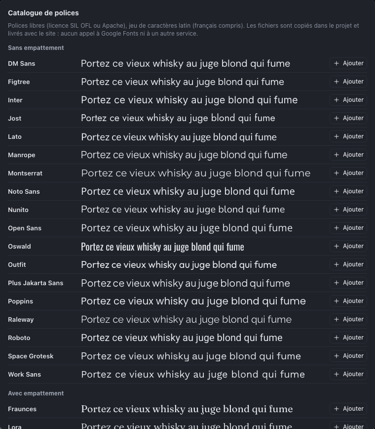

Le design system rassemble les **valeurs nommées** du site : ses couleurs, ses tailles, ses polices et ses styles de texte. On les appelle des **tokens**. Il accueille aussi la **feuille CSS du projet**, pour les effets que l’inspecteur ne propose pas. C’est l’équivalent des couleurs et de la typographie globales d’Elementor (Site Settings) ou de Tatsu.

Un élément qui utilise un token ne contient pas la valeur, mais une référence : changez la couleur « Primaire » dans le design system, tous les boutons, fonds et textes qui l’utilisent changent aussitôt, sur toutes les pages.

Ouvrez-le avec l’icône **Design system** (la palette) de la barre d’outils. Il prend la place de l’inspecteur ; un second clic sur l’icône rend l’inspecteur.


## Couleurs

Chaque couleur a un **nuancier** et un **nom**. Nommez les couleurs par leur **rôle** plutôt que par leur teinte : « Primaire », « Accent », « Texte », « Fond clair » restent justes le jour où la charte change, « Vert » non.

Pour l’utiliser, dans l’inspecteur d’un élément, choisissez le nom de la couleur dans la liste à côté du nuancier (**Couleur du texte**, **Couleur de fond**).

> Vérifiez le **contraste** entre texte et fond : au moins 4,5:1 pour un texte courant (critère d’accessibilité WCAG). Le Studio ne le mesure pas encore ; un outil comme le *Contrast Checker* de WebAIM le fait en ligne.

## Tailles : espacements, arrondis, largeurs, tailles de police

Quatre familles de tailles :

| Famille | Pour |
|---|---|
| **Espacements** | Paddings, marges, espacements (gap) : « S », « M », « L », « Section »… |
| **Arrondis** | Arrondi des boutons, cartes, images |
| **Largeurs maximales** | Largeur du contenu : « Texte » (700 px), « Page » (1120 px)… |
| **Tailles de police** | Tailles de texte hors styles de texte |

Une taille a une valeur de **Base** et, si besoin, une valeur par **breakpoint** (Tablette, Mobile). Un token « Section » à 80 px en base et 40 px en mobile règle d’un coup l’espacement de toutes les sections sur mobile, sans toucher aux pages.

Pour utiliser une taille, dans un champ de dimension de l’inspecteur, ouvrez la liste des **unités** : les tokens de taille y figurent, dans le groupe **Tokens**.

## Polices

Une police du design system est une **liste de familles, par ordre de préférence**, par exemple `Lora, Georgia, serif` : le navigateur utilise la première qu’il trouve. Pour que le site s’affiche partout avec la police de la charte, **importez-la** : ses fichiers sont alors livrés avec le site.

### Le catalogue de polices

Le bouton **Catalogue de polices…**, sous la section **Polices**, propose 25 polices libres parmi les plus utilisées sur le web : Inter, Roboto, Open Sans, Montserrat, Lato, Poppins, Raleway, Nunito, Playfair Display, Merriweather, Lora, Source Serif…



1. Ouvrez le catalogue : chaque police est montrée sur une phrase d’exemple.
2. Cliquez sur **Ajouter** : les fichiers de la police entrent dans la médiathèque du projet, et une police du même nom est créée dans le design system (par exemple `Inter, sans-serif`).
3. Utilisez-la dans vos **styles de texte** ou dans le champ **Police** de l’inspecteur.

Ces polices sont **libres** (licence SIL Open Font License, ou Apache pour Roboto Slab) : on peut les utiliser sur les sites des clients sans rien payer. La plupart sont **variables** : un seul fichier couvre toutes les graisses, de la plus fine à la plus grasse.

### Importer une police de la charte

Pour une police qui n’est pas dans le catalogue, importez son fichier **WOFF2** dans la **médiathèque** (bouton **Importer**). Le Studio lit la famille, la graisse et le style dans le nom du fichier (`Marque-BoldItalic.woff2` donne « Marque », 700, italique) ; corrigez-les dans la fiche du média si besoin. Importez un fichier par graisse et par style utilisés (ou un seul fichier pour une police variable), puis écrivez le nom de la famille **en tête** d’une police du design system : `Marque, Helvetica, sans-serif`.

> **Licence.** Une police de marque achetée pour la bureautique n’autorise pas toujours l’usage sur un site web. Vérifiez que la licence couvre le **web** (« webfont » ou « self-hosting ») avant d’importer le fichier. Les polices de Google Fonts, de Fontshare ou de la Velvetyne sont libres, et souvent disponibles en WOFF2.

> **Pourquoi pas Google Fonts en ligne ?** Charger une police depuis les serveurs de Google transmet l’adresse IP de chaque visiteur à Google, aux États-Unis : depuis l’arrêt Schrems II, c’est un risque RGPD pour vos clients. Les polices importées sont servies par le site lui-même, sans aucun appel extérieur.

### Les polices de repli

Terminez toujours une pile par une famille générique (`serif`, `sans-serif`, `monospace`) : elle s’affiche si la police principale manque ou n’est pas encore chargée. Sans police importée, seules les polices présentes **sur l’appareil du visiteur** s’affichent ; quelques piles système sûres :

| Style | Pile |
|---|---|
| Sans empattement, interface | `system-ui, -apple-system, Segoe UI, Roboto, sans-serif` |
| Avec empattement, classique | `Georgia, Times New Roman, serif` |
| Humaniste | `Optima, Candara, Noto Sans, sans-serif` |
| Chasse fixe | `ui-monospace, Menlo, Consolas, monospace` |

## Styles de texte

Un style de texte combine une **police**, une **graisse**, une **casse** (capitales…) et l’**italique**, et pour chaque breakpoint une **taille**, un **interligne** et un **espacement des lettres**. C’est la typographie du site, définie une fois.

Sept styles ont un rôle particulier : **Texte courant** et **Titre 1** à **Titre 6** s’appliquent **automatiquement** aux paragraphes et aux titres du niveau correspondant, sans rien régler sur les éléments. Créez-les avec les boutons du même nom en bas de la section. Le modèle Atelier Nord définit par exemple « Titre 1 » : Georgia, 700, 52 px en base et 36 px en mobile.

**Style personnalisé** crée un style libre (« Chapô », « Légende », « Grand chiffre »…), à appliquer à un élément depuis l’inspecteur, section **Style**, liste **Style de texte**.

Un réglage fait directement sur un élément (une taille de police, par exemple) **l’emporte** sur son style de texte. Pour garder une typographie cohérente, préférez modifier le style plutôt que les éléments un par un.

## CSS du projet

Pour un effet que l’inspecteur ne propose pas, le designer du projet peut écrire une feuille de style, dans la section **CSS du projet** du design system :

1. Sur l’élément, dans l’inspecteur, section **Avancé**, donnez-lui une ou plusieurs **Classes CSS**, par exemple `carte-relief` : des minuscules, des chiffres et des tirets, sans le préfixe `ns-`, réservé au Studio.
2. Dans **CSS du projet**, écrivez la règle :

```css
.carte-relief {
  border-left: 6px solid var(--ns-color-primary);
  transition: transform .3s;
}
.carte-relief:hover { transform: translateY(-4px); }
@media (prefers-reduced-motion: reduce) {
  .carte-relief { transition: none; }
}
```

L’éditeur colore la syntaxe (sélecteurs, propriétés, valeurs, chaînes, commentaires) et le canvas applique la feuille en direct. Elle **l’emporte** sur les réglages de l’inspecteur. Les tokens s’utilisent par leurs variables (`var(--ns-color-primary)`, liste dans le README de l’export).

- **Sont admis** : les règles ordinaires, `@media`, `@supports`, `@container` et `@keyframes`. Les images viennent de la médiathèque, avec la liste **Insérer une image de la médiathèque…**, qui écrit `url("ns-asset:…")`.
- **Sont refusés** : `@import`, `@font-face` (passez par les polices importées), les adresses externes et tout ce qui pourrait exécuter du code. L’erreur est indiquée à la ligne près ; tant qu’elle n’est pas corrigée, la dernière version valide reste appliquée.
- **Avertissements** (la feuille s’applique quand même) : contour de focus supprimé sans règle `:focus-visible`, contenu masqué hors media query, animation sans règle `prefers-reduced-motion`, `!important`, et règles visant les classes internes `ns-…`. Ces classes changent d’une version du Studio à l’autre : visez vos propres classes.

Réservez cette feuille aux vrais besoins : un réglage de l’inspecteur reste plus simple à maintenir et vérifié par le Studio.

## Modifier et supprimer un token

- Une modification s’applique **immédiatement à tout le site** et s’annule avec <kbd>⌘</kbd> <kbd>Z</kbd>, comme toute action.
- Renommer un token ne casse rien : les éléments le désignent par un identifiant interne, pas par son nom.
- Un token **utilisé** ne peut pas être supprimé : le Studio indique combien d’éléments ou de styles s’en servent. Remplacez-le d’abord sur ces éléments.

## Méthode conseillée

1. **Avant de construire les pages**, posez la charte : 3 à 6 couleurs, une ou deux polices, les styles Texte courant, Titre 1, Titre 2 et Titre 3 (avec leurs tailles mobiles), deux ou trois espacements.
2. **En construisant**, utilisez les tokens plutôt que des valeurs personnalisées.
3. **Pour une variante de charte** (le même site pour un autre client), dupliquez le projet depuis l’écran Projets et modifiez seulement le design system.
