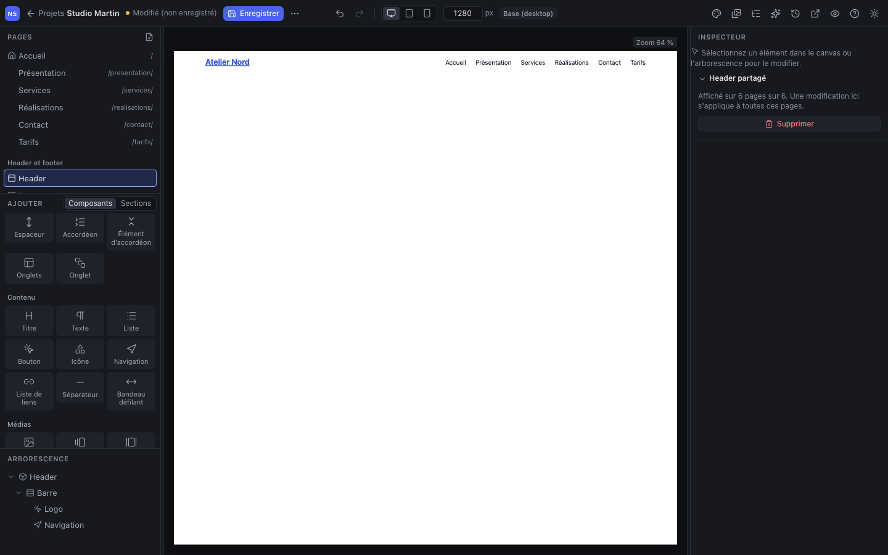
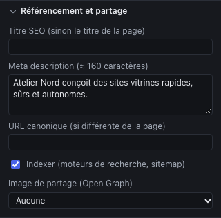

Un projet du Studio est un site complet : des pages, un header et un footer communs, des menus, des réglages de référencement. Ce chapitre fait le tour de ce qui dépasse la page.

## Les pages

Le panneau **Pages**, en haut à gauche, liste les pages avec leur adresse. La maison signale la **page d’accueil**, un œil barré une page **non publiée**.

- **Ajouter** une page : l’icône en haut à droite du panneau. La nouvelle page reprend la largeur et les marges de l’accueil.
- **Régler** une page : ouvrez-la et appuyez sur <kbd>Échap</kbd> ; l’inspecteur affiche la section **Page**.

| Réglage | Rôle |
|---|---|
| **Titre** | Le nom de la page dans le Studio, dans l’onglet du navigateur et, par défaut, dans les résultats de recherche |
| **Adresse (slug)** | La fin de l’URL : `tarifs` donne `/tarifs/`. Minuscules, chiffres et tirets ; `/` pour une sous-adresse (`offres/pro` donne `/offres/pro/`) |
| **Afficher le header**, **Afficher le footer** | À décocher pour une page d’atterrissage sans navigation |
| **Publier (inclure dans l’export)** | Une page décochée reste dans le Studio mais n’est pas exportée : utile pour un brouillon |
| Monter, descendre, dupliquer, supprimer | L’ordre est celui de la liste ; il ne change pas les menus |
| **Définir comme page d’accueil** | La page passe à l’adresse `/` |

> **Changer une adresse ne casse aucun lien.** Les menus, boutons et images qui mènent à une page la désignent par un identifiant, pas par son adresse : ils suivent automatiquement. L’inspecteur indique combien d’éléments lient vers la page. En revanche, une adresse **déjà connue de Google** ou partagée ailleurs doit être redirigée (voir « Redirections » plus bas).

La page **404** (« page introuvable ») est créée automatiquement à l’export, avec le header, le footer et un lien vers l’accueil. Elle n’apparaît pas dans le Studio.

## Header et footer

Le header et le footer sont **partagés** : ils s’affichent sur toutes les pages (sauf celles où vous les avez masqués) et se modifient **une seule fois**.

Pour les modifier, cliquez sur **Header** ou **Footer** dans la section **Header et footer** du panneau Pages. Le canvas n’affiche plus que lui ; vous l’éditez comme une page : bibliothèque, arborescence, inspecteur. L’inspecteur rappelle sur combien de pages il est affiché.

Un projet sans header ou sans footer propose **Créer le header** ou **Créer le footer** : le Studio en crée un de départ (logo et navigation, ou mention de copyright et liens), à personnaliser. **Supprimer**, dans l’inspecteur, le retire de toutes les pages.

Un site a un seul header et un seul footer. Pour un header différent sur une page, masquez le header partagé sur cette page et construisez le sien dans la page.

## Les menus

Un **menu** est une liste de liens, gérée dans le panneau **Menus** (icône de liste dans la barre d’outils). Un menu ne s’affiche pas seul : il faut un composant **Navigation** ou **Liste de liens** qui le désigne.

- **Nouveau menu** : un menu de plus (« Pied de page », « Mentions »…).
- **Ajouter une entrée** : un **Libellé** et un **Lien**, vers une page du site, une adresse (URL, `mailto:`, `tel:`) ou un fichier de la médiathèque.
- Les flèches réordonnent les entrées ; **En faire une sous-entrée** la range sous l’entrée précédente (un seul niveau de sous-menu) ; **Remonter au premier niveau** fait l’inverse.

Côté composant :

| Composant | Réglages |
|---|---|
| **Navigation** | Le **Menu** affiché ; **Replier en bouton** sur mobile, sur tablette et mobile, ou jamais ; le **libellé du bouton** (« Menu ») ; un **nom accessible** (« Navigation principale ») |
| **Liste de liens** | Le **Menu** ; la **Disposition** en colonne ou en ligne |

La page en cours est mise en évidence dans la navigation, sans réglage. Les sous-entrées s’ouvrent au survol et au clavier sur desktop, et se déplient dans le menu replié sur mobile.

## Référencement et partage

Chaque page a sa section **Référencement et partage** dans l’inspecteur (rien de sélectionné).

| Champ | Conseil |
|---|---|
| **Titre SEO** | Le titre dans Google et dans l’onglet. Vide : le titre de la page. 60 caractères au plus |
| **Meta description** | Le résumé sous le titre dans Google : une ou deux phrases qui donnent envie de cliquer, 160 caractères au plus. Une par page, toutes différentes |
| **URL canonique** | À laisser vide, sauf si la même page existe ailleurs sous une autre adresse |
| **Indexer** | Décochez pour une page que les moteurs ne doivent pas référencer (merci, confirmation…) ; elle sort aussi du sitemap |
| **Image de partage (Open Graph)** | L’image affichée quand on partage la page sur les réseaux sociaux ; 1200 × 630 px est le format le plus sûr |

Les contrôles avant export signalent un titre ou une description manquants ou trop longs, une page sans titre H1 ou avec plusieurs, et des niveaux de titre sautés.

## Les réglages du site

Toujours avec rien de sélectionné, la section **Site** de l’inspecteur règle :

- le **Nom du projet**, utilisé aussi dans le texte de départ du header et du footer ;
- la **Langue** du site (`fr`, `en-GB`…), déclarée aux navigateurs et aux lecteurs d’écran ;
- l’**URL canonique** du site (`https://www.client.fr`) : **indispensable** pour générer le **sitemap** et les adresses absolues du partage sur les réseaux sociaux. Sans elle, l’export vous prévient.

### Redirections

Quand un site existant est refait, ses anciennes adresses doivent mener aux nouvelles pages, pour les visiteurs comme pour Google. La section **Redirections** les liste : une **Ancienne adresse** (`/nos-services/`), une destination **Vers** (une page du site ou une adresse) et la case **Permanente (301)**, à cocher pour un déménagement définitif.

Un site statique ne peut pas imposer une vraie redirection 301 à lui seul : l’export fournit une page qui redirige, plus les fichiers de configuration pour l’hébergeur. Le chapitre [Publier et livrer](11-publier-et-livrer.md) explique quoi en faire.

## Vérifier le site comme un visiteur

**Aperçu du site**, dans la barre d’outils, ouvre le site dans un nouvel onglet : on y navigue de page en page par les menus et les liens, sans les outils d’édition. Rétrécissez la fenêtre pour voir le comportement sur tablette et mobile. L’aperçu reflète les modifications en cours, même non enregistrées.
