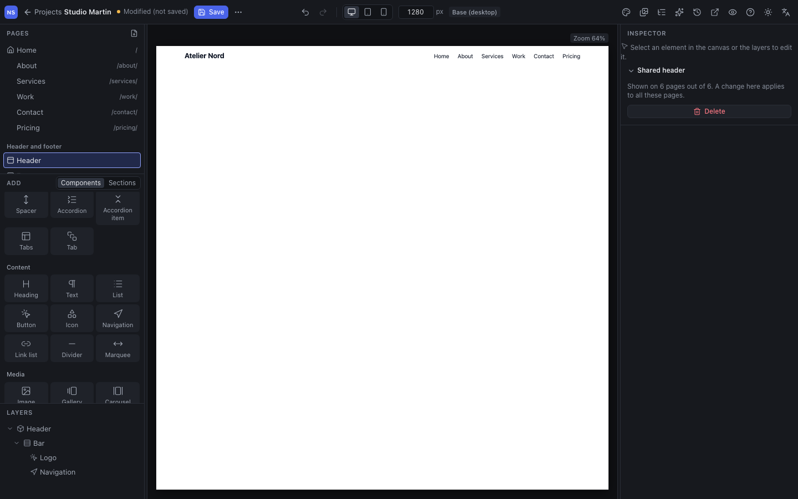
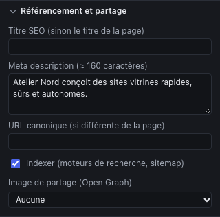

A Studio project is a complete site: pages, a shared header and footer, menus, search engine settings. This chapter covers the parts of your site beyond individual pages.

## Pages

The **Pages** panel, at the top left, lists the pages with their address. The house marks the **home page**, a crossed-out eye an **unpublished** page.

- **Add** a page: the icon at the top right of the panel. The new page takes the width and margins of the home page.
- **Set up** a page: open it and press <kbd>Esc</kbd>; the inspector shows the **Page** section.

| Setting | Role |
|---|---|
| **Title** | The page's name in the Studio, in the browser tab and, by default, in search results |
| **Address (slug)** | The end of the URL: `pricing` gives `/pricing/`. Lowercase letters, digits and hyphens; `/` for a sub-address (`offers/pro` gives `/offers/pro/`) |
| **Show the header**, **Show the footer** | Untick for a landing page without navigation |
| **Publish (include in the export)** | An unticked page stays in the Studio but is not exported: useful for a draft |
| Move up, move down, duplicate, delete | The order is that of the list; it does not change the menus |
| **Set as home page** | The page moves to the `/` address |

> **Changing an address breaks no link.** The menus, buttons and images that lead to a page point to it by an id, not by its address: they follow automatically. The inspector says how many elements link to the page. However, an address **already known to Google** or shared elsewhere must be redirected (see "Redirects" below).

The **404** page ("page not found") is created automatically at export, with the header, the footer and a link to the home page, in the site's language. It does not appear in the Studio.

## Header and footer

The header and the footer are **shared**: they show on every page (except those where you hid them) and are edited **only once**.

To edit them, click **Header** or **Footer** in the **Header and footer** section of the Pages panel. The canvas then shows only that part; you edit it like a page: library, layers, inspector. The inspector says on how many pages it is shown.

A project without a header or footer offers **Create the header** or **Create the footer**: the Studio creates a starting one (logo and navigation, or copyright notice and links), to customize. **Delete**, in the inspector, removes it from every page.

A site has a single header and a single footer. For a different header on one page, hide the shared header on that page and build its own in the page.

## Menus

A **menu** is a list of links, managed in the **Menus** panel (list icon in the toolbar). A menu does not appear by itself: a **Navigation** or **Link list** component must point to it.

- **New menu**: one more menu ("Footer", "Legal"…).
- **Add an entry**: a **Label** and a **Link**, to a page of the site, an address (URL, `mailto:`, `tel:`) or a file of the media library.
- The arrows reorder the entries; **Make it a sub-entry** puts it under the previous entry (a single submenu level); **Move to top level** does the reverse.

On the component side:

| Component | Settings |
|---|---|
| **Navigation** | The **Menu** shown; **Collapse into a button** on mobile, on tablet and mobile, or never; the **button label** ("Menu"); an **accessible name** ("Main navigation") |
| **Link list** | The **Menu**; the **Layout** in a column or in a row |

The current page is highlighted in the navigation, without any setting. Sub-entries open on hover and with the keyboard on desktop, and unfold in the collapsed menu on mobile.

## Search and sharing

Each page has its **Search and sharing** section in the inspector (nothing selected).

| Field | Advice |
|---|---|
| **SEO title** | The title in Google and in the tab. Empty: the page title. 60 characters at most |
| **Meta description** | The summary under the title in Google: one or two sentences that make people want to click, 160 characters at most. One per page, all different |
| **Canonical URL** | Leave empty, unless the same page exists elsewhere under another address |
| **Index** | Untick for a page search engines must not list (thank you, confirmation…); it also leaves the sitemap |
| **Sharing image (Open Graph)** | The image shown when the page is shared on social networks; 1200 × 630 px is the safest format |

The pre-export checks report a missing or too long title or description, a page without an H1 heading or with several, and skipped heading levels.

## Site settings

Still with nothing selected, the **Site** section of the inspector sets:

- the **Project name**, also used in the starting text of the header and footer;
- the site's **Language** (`en`, `fr`, `en-GB`…), declared to browsers and screen readers. It also sets the language of the texts the Studio writes into the site: default texts of the components you insert, sections of the library, the 404 page, accessible labels of the carousel and the gallery. It is independent of the interface language: you can work in English on a French site;
- the site's **Canonical URL** (`https://www.client.com`): **essential** to generate the **sitemap** and the absolute addresses used when sharing on social networks. Without it, the export warns you.

### Redirects

When an existing site is rebuilt, its old addresses must lead to the new pages, for visitors as for Google. The **Redirects** section lists them: an **Old address** (`/our-services/`), a **To** destination (a page of the site or an address) and the **Permanent (301)** box, to tick for a final move.

A static site cannot enforce a real 301 redirect on its own: the export provides a page that redirects, plus configuration files for the host. The chapter [Publish and deliver](11-publish-and-deliver.md) explains what to do with them.

## Checking the site like a visitor

**Site preview**, in the toolbar, opens the site in a new tab: you browse from page to page through the menus and links, without the editing tools. Narrow the window to see the behavior on tablet and mobile. The preview reflects the current changes, even unsaved ones.
