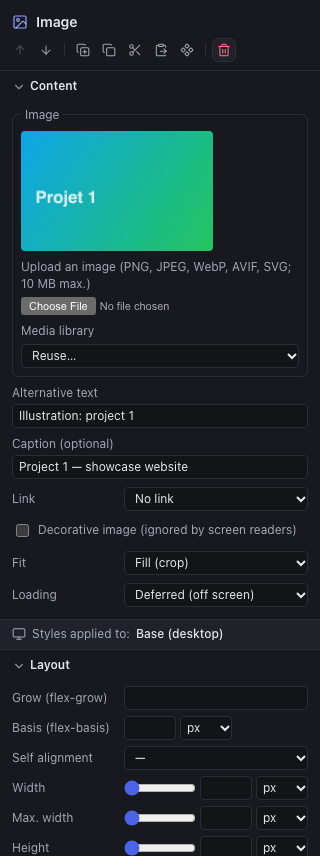
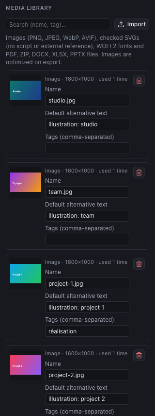

Each project has its **media library**: the images, SVGs and downloadable files of the site. Unlike WordPress, it is not shared between projects.

## Accepted formats

| Type | Formats | Max. size | At export |
|---|---|---|---|
| **Images** | PNG, JPEG, WebP, AVIF | 10 MB | Optimized automatically (see below) |
| **SVG** | SVG | 1 MB | Copied as they are. The Studio refuses SVGs that contain a script or call an external resource |
| **Fonts** | WOFF2 | 2 MB | Delivered with the site (see [The design system](05-design-system.md)) |
| **Files** | PDF, ZIP, DOCX, XLSX, PPTX | 20 MB | Copied as they are, to offer for download |

Videos are not imported: the **Video** component shows a YouTube or Vimeo video from its address.

## Adding an image to a page

1. Insert an **Image** component (library, Components tab, Media category), or select an existing image.
2. In the inspector, **Content** section:
   - **Upload an image**: choose the file, type its **alternative text** (or tick **Decorative image**), then **Add the image**. The image enters the media library and shows;
   - or **Media library > Reuse…**: choose an image already imported.

The other settings of the image:

| Setting | Role |
|---|---|
| **Alternative text** | What a screen reader reads, and what shows if the image does not load. Required, except for a decorative image |
| **Caption (optional)** | A text shown under the image |
| **Link** | Makes the image clickable: a page, an address or a file |
| **Decorative image** | The image adds nothing to the meaning (pattern, mood illustration): screen readers ignore it |
| **Fit** | **Fill (crop)**: the image covers its whole box, even if it is cut. **Contain**: the whole image is visible, with bands if the ratios differ |
| **Loading** | **Deferred**: loaded as it approaches the screen (the default). **Immediate**: for the main image at the top of the page, which must show at once |

In the styles, **Aspect ratio** (16:9, square…) and **Image framing** (center, top, bottom…) set the cropping when the fit is "Fill".

## Galleries

The **Gallery** component (library, Media category) presents a series of images, like a portfolio:

- **Images**: add them from the media library (**Add from the media library**) or import several at once (**Import images…**). Each has its **alternative text** (empty: decorative image) and its optional **caption**; the arrows change the order.
- **Layout**: **Masonry** keeps each image's natural height, in staggered columns; **Tiles** crops every image to the same **ratio** (square, 4:3, 16:9…).
- **Columns** and **Spacing**, in the **Layout** section of the inspector, are set per screen size: three columns on desktop, two on tablet, one on mobile by default.
- **Enlarge on click**: a click opens the image large on a dark background, with the previous and next images (keyboard arrows), and <kbd>Esc</kbd> to close. Without JavaScript, the link simply opens the image.

In masonry, images read column by column. The order of the list stays the one followed by the keyboard and screen readers: put the most important images first. Images are optimized at export like those of the Image component.

## Carousels

The **Carousel** component (Media category) scrolls a series of images horizontally:

- **Images**: as for the gallery, with alternative text and caption; **Accessible name** describes the whole ("Our work").
- **Visible images**: one by default; tablet and mobile take the value of the larger screen when the field is empty. **Spacing** separates the images, **Image ratio** crops them (or keeps their original shape).
- The **‹** and **›** buttons go to the previous or next image, returning to the start after the last one. You can also swipe, or use the keyboard arrows once the carousel is selected. Without JavaScript, the strip stays scrollable.
- **Autoplay**: optional and off by default. It stops on hover, on focus and with the **Pause** button, and never starts for visitors who reduced animations. The canvas does not scroll by itself; the site preview does.

A carousel hides most of its images: for important content, a gallery or a grid stays more readable.

### Writing a good alternative text

- Describe what the image **brings**, in one sentence: "Bright studio with three workstations", not "image" or "studio-photo-03.jpg".
- For an image link, describe the **destination**: "See the Martin Bakery project".
- An image that contains text: repeat the text.
- A purely decorative image: tick **Decorative image** rather than writing a meaningless text.

An image of the media library can also serve as a **background image** for a box (chapter [Styling](04-styling-and-responsive.md)): it is then published without optimization, prepare it accordingly.

## The media library

The **Media library** button (images icon) of the toolbar opens the project's panel.

- **Import**: one or several files at once (images, SVGs, documents).
- **Search**: by name, file name or tag.
- For each media file: its **size**, the indication **used N times** or **unused**, a **Name**, a **Default alternative text** (offered when the image is chosen in a component) and **Tags** to find your way ("work", "team"…).
- The trash **removes** a media file from the media library. A media file still in use cannot be removed: the Studio says how many elements use it.

To offer a document for download, import it into the media library, then choose it in the **Link** of a button, an image or a menu entry ("File to download" group).

## Preparing your images

The Studio optimizes images at export: it converts them to **WebP** and produces several widths (480, 960 and 1600 px, never enlarging the original). The visitor's browser loads the smallest one that suits its screen. So you do not have to prepare several versions, but:

- **import a single version, large enough**: 1600 px wide for a full-width image, 800 px for half width; beyond that, it is useless weight;
- **crop before importing** when the framing matters: the Studio's cropping (Fill, Framing) stays approximate;
- **prefer SVG** for logos and pictograms: sharp at every size, very light;
- **name your files** clearly (`studio-workstations.jpg`): the name is kept in the exported sources.

## Current limits

- No folders, no replacing a file with a new version, no automatic cleanup of unused media: remove them by hand ("unused" indication).
- No hosted video.
- To reuse an image in another project, import it again.
