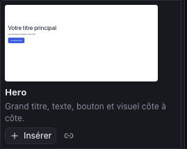
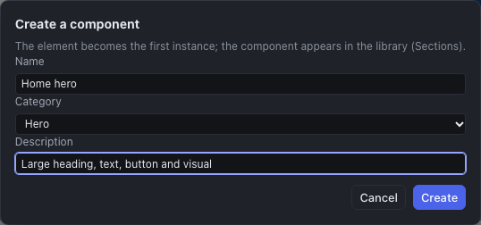
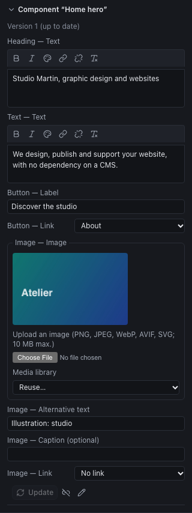

Three levels of reuse, from the smallest to the largest:

| To reuse | Use | Scope |
|---|---|---|
| A ready-made section structure | The **library sections** | Every project |
| A section of the site, identical on several pages | A **reusable component** | The project |
| A whole site as a starting point | A **site template** | Every project |

## Library sections

The **Sections** tab of the library (at the top left, next to **Components**) shows ready-to-use sections, with a preview in the colors and fonts of your site: hero, about, features, testimonials, pricing, team, gallery, call to action, contact…

- The **Search** field and the **Category** list filter the sections.
- **Insert** places an **independent copy**: you change it freely, nothing links it to the library any more. Its text is written in the site's language.
- The **link** icon (insert linked) places a **linked instance**: the section becomes a reusable component of the project (see below).

As in the Components tab, the section is inserted into the selected box, after the selected element, or at the end of the page.

## Reusable components

A reusable component is a section you design **once** and place on **several pages**: a contact band, a call-to-action block, a service card. It is the equivalent of Elementor's "Global Widgets" or Tatsu's global sections, with an important difference: **updates are versioned and go through your approval**.

### Creating a component

1. Select the section (often a named box, such as "Hero").
2. In the inspector, click the **Create a reusable component** icon (among the actions at the top).
3. Give it a **Name**, a **Category** and, if you wish, a **Description**, then **Create**.

The element becomes the **first instance** of the component. The component appears in the **Sections** tab ("Project components" heading) and in the **Pages** panel ("Shared components").

### Placing the component elsewhere

In the **Sections** tab, **Project components** heading:

- the **link** icon places a **linked instance**, which can receive the new versions;
- **Insert** places an **independent copy**, detached from the component.

### Customizing an instance: the parameters

The texts, links, images and lists of a component are its **parameters**: each instance can have its own. Select the instance: the **Component "…"** section of the inspector lists its parameters ("Heading — Text", "Button — Link"…), to fill in for this instance.

Everything else (structure, styling, animations) comes from the component. If you change an instance **outside its parameters** (a color, a spacing), the inspector says so: these changes will be **overwritten** by the next update. For an instance to depart from the model durably, **detach it**.

### Updating a component

1. Open the component: the **Edit the component** icon (pencil) of an instance, or its name in **Shared components** of the Pages panel.
2. Change it like a page. The instances do not change yet.
3. In the inspector (nothing selected), click **Publish version N**: the version is frozen.
4. Click **Update instances**: the Studio lists the changes that will be applied; **Update** applies them, as a single action to undo.

An instance that is behind says so ("version 2 available") and can also be updated alone, with its **Update** button. The parameters filled in each instance are kept.

### Detaching an instance

The **Detach (independent copy)** icon cuts the link: the instance becomes an ordinary section, editable without constraints, which will no longer receive updates.

### Limits

- A component belongs to its **project**: to find it in another site, go through a site template.
- The list of parameters is fixed when the component is **created**: a text added to the component afterwards is not a parameter.
- The update summarizes the changes, without a visual preview before approval (undo remains possible).

## Site templates

A site template is a **complete project** (pages, header and footer, menus, design system, media, components) that serves as a starting point for new projects. Three templates come with the Studio, in English and in French, in the **Template** list of the Projects screen ("Complete sites" group):

| Template | Style | Pages |
|---|---|---|
| **Atelier Nord** | Sober and light, for a first site | Home, About, Services, Work, Contact |
| **Studio Orbe — creative agency** | Dark and graphic: Space Grotesk, gradients, animated grids | Home, The studio, Expertise, Projects, Contact |
| **Valéor Partners — consulting** | Light and editorial: Fraunces, fir green and brass; suited to a consulting, law or architecture firm | Home, The firm, Expertise, Fees, Contact |

Each template exists in English and in French, page addresses included. The list shows a template's language when it is not that of the interface.

The texts, contact details and visuals of these templates are fictional: replace them with your client's. Their visuals are generated illustrations that you can use in your projects; their fonts come from the catalog and are already in the media library. Studying how they are built (layers, design system, animations) is also a good way to learn the Studio.

### Saving a template

1. Save the project (the template takes the **saved version**).
2. **⋯** menu (More actions) > **Save as site template…**
3. Give it a name and, if you wish, a description.

The template appears on the **Projects** screen, in the **Template** list ("Complete sites" group) and under **My site templates**, where a trash icon deletes it. Projects created from a template do not depend on it: deleting or changing the template does not touch them.

### Preparing a good template

- **A complete design system**: colors named by role, fonts, text styles (Body text, Heading 1 to 3). That is what makes the template quick to adapt.
- **Explicit demo texts** ("Page heading", "Two sentences of introduction"), so that nothing goes online by mistake.
- **Royalty-free images** or neutral visuals.
- **Reusable components** for the repeated blocks: a new site inherits them.
