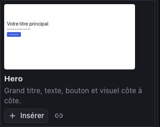
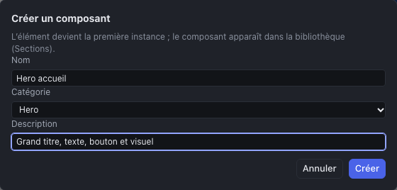
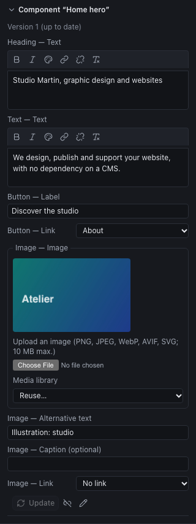

Trois niveaux de réutilisation, du plus petit au plus grand :

| Pour réutiliser | Utilisez | Portée |
|---|---|---|
| Une structure de section toute faite | Les **sections de la bibliothèque** | Tous les projets |
| Une section du site, à l’identique sur plusieurs pages | Un **composant réutilisable** | Le projet |
| Un site entier comme point de départ | Un **modèle de site** | Tous les projets |

## Les sections de la bibliothèque

L’onglet **Sections** de la bibliothèque (en haut à gauche, à côté de **Composants**) montre des sections prêtes à l’emploi, avec un aperçu dans les couleurs et les polices de votre site : hero, présentation, atouts, témoignages, tarifs, équipe, galerie, appel à l’action, contact…

- Le champ **Rechercher** et la liste **Catégorie** filtrent les sections.
- **Insérer** place une **copie indépendante** : vous la modifiez librement, rien ne la relie plus à la bibliothèque.
- L’icône de **lien** (Insérer liée) place une **instance liée** : la section devient un composant réutilisable du projet (voir plus bas).

Comme dans l’onglet Composants, la section s’insère dans la boîte sélectionnée, après l’élément sélectionné, ou à la fin de la page.

## Les composants réutilisables

Un composant réutilisable est une section que vous concevez **une fois** et placez sur **plusieurs pages** : un bandeau de contact, un bloc d’appel à l’action, une carte de service. C’est l’équivalent des « Global Widgets » d’Elementor ou des sections globales de Tatsu, avec une différence importante : **les mises à jour sont versionnées et passent par votre validation**.

### Créer un composant

1. Sélectionnez la section (souvent une boîte nommée, comme « Hero »).
2. Dans l’inspecteur, cliquez sur l’icône **Créer un composant réutilisable** (parmi les actions en haut).
3. Donnez-lui un **Nom**, une **Catégorie** et, si vous voulez, une **Description**, puis **Créer**.

L’élément devient la **première instance** du composant. Le composant apparaît dans l’onglet **Sections** (rubrique « Composants du projet ») et dans le panneau **Pages** (« Composants partagés »).

### Placer le composant ailleurs

Dans l’onglet **Sections**, rubrique **Composants du projet** :

- l’icône de **lien** place une **instance liée**, qui pourra recevoir les nouvelles versions ;
- **Insérer** place une **copie indépendante**, détachée du composant.

### Personnaliser une instance : les paramètres

Les textes, liens, images et listes d’un composant sont ses **paramètres** : chaque instance peut avoir les siens. Sélectionnez l’instance : la section **Composant « … »** de l’inspecteur liste ses paramètres (« Titre — Texte », « Bouton — Lien »…), à remplir pour cette instance.

Tout le reste (structure, mise en forme, animations) vient du composant. Si vous modifiez une instance **en dehors de ses paramètres** (une couleur, un espacement), l’inspecteur l’indique : ces changements seront **écrasés** à la prochaine mise à jour. Pour qu’une instance s’écarte durablement du modèle, **détachez-la**.

### Faire évoluer le composant

1. Ouvrez le composant : l’icône **Modifier le composant** (crayon) d’une instance, ou son nom dans **Composants partagés** du panneau Pages.
2. Modifiez-le comme une page. Les instances ne changent pas encore.
3. Dans l’inspecteur (rien de sélectionné), cliquez sur **Publier la version N** : la version est figée.
4. Cliquez sur **Mettre à jour les instances** : le Studio liste les changements qui vont être appliqués ; **Mettre à jour** les applique, en une seule action à annuler.

Une instance en retard l’indique (« version 2 disponible ») et peut aussi être mise à jour seule, avec son bouton **Mettre à jour**. Les paramètres renseignés dans chaque instance sont conservés.

### Détacher une instance

L’icône **Détacher (copie indépendante)** coupe le lien : l’instance devient une section ordinaire, modifiable sans contrainte, qui ne recevra plus les mises à jour.

### Limites

- Un composant appartient à son **projet** : pour le retrouver dans un autre site, passez par un modèle de site.
- La liste des paramètres est fixée à la **création** du composant : un texte ajouté ensuite au composant n’est pas un paramètre.
- La mise à jour résume les changements, sans aperçu visuel avant validation (l’annulation reste possible).

## Les modèles de site

Un modèle de site est un **projet complet** (pages, header et footer, menus, design system, médias, composants) qui sert de point de départ à de nouveaux projets. Trois modèles sont fournis avec le Studio, dans la liste **Modèle** de l’écran Projets (groupe « Sites complets ») :

| Modèle | Style | Pages |
|---|---|---|
| **Atelier Nord** | Sobre et clair, pour un premier site | Accueil, Présentation, Services, Réalisations, Contact |
| **Studio Orbe — agence créative** | Sombre et graphique : Space Grotesk, dégradés, grilles animées | Accueil, L’agence, Expertises, Projets, Contact |
| **Cabinet Valéor — conseil** | Clair et éditorial : Fraunces, vert sapin et laiton ; adapté à un cabinet de conseil, d’avocats ou d’architectes | Accueil, Le cabinet, Expertises, Honoraires, Contact |

**Studio Orbe** et **Cabinet Valéor** existent aussi en anglais (« Studio Orbe — creative agency », « Valéor Partners — consulting ») : un site en anglais, adresses des pages comprises. La liste indique la langue d’un modèle quand ce n’est pas celle de l’interface.

Les textes, coordonnées et visuels de ces modèles sont fictifs : remplacez-les par ceux de votre client. Leurs visuels sont des illustrations générées, libres de droits ; leurs polices viennent du catalogue et sont déjà dans la médiathèque. Étudier comment ils sont construits (arborescence, design system, animations) est aussi une bonne façon d’apprendre le Studio.

### Enregistrer un modèle

1. Enregistrez le projet (le modèle reprend la **version enregistrée**).
2. Menu **⋯** (Plus d’actions) > **Enregistrer comme modèle de site…**
3. Donnez-lui un nom et, si vous voulez, une description.

Le modèle apparaît dans l’écran **Projets**, dans la liste **Modèle** (groupe « Sites complets ») et sous **Mes modèles de site**, où une corbeille le supprime. Les projets créés à partir d’un modèle n’en dépendent pas : supprimer ou modifier le modèle ne les touche pas.

### Bien préparer un modèle

- **Un design system complet** : couleurs nommées par rôle, polices, styles de texte (Texte courant, Titre 1 à 3). C’est ce qui rend le modèle rapide à décliner.
- **Des textes de démonstration explicites** (« Titre de la page », « Deux phrases de présentation »), pour que rien ne parte en ligne par erreur.
- **Des images libres de droits** ou des visuels neutres.
- **Des composants réutilisables** pour les blocs répétés : un nouveau site les hérite.
