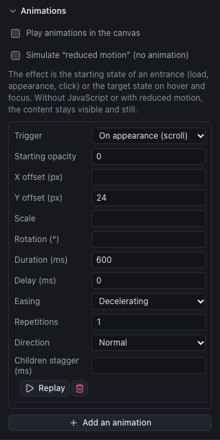

The Studio offers **declarative** animations: you describe the effect (a fade, a slide, a zoom) and its trigger, the Studio produces the code, light and accessible. It is the equivalent of the "entrance animations" and hover effects of Elementor or Tatsu.

## Adding an animation

1. Select the element.
2. At the bottom of the inspector, **Animations** section, click **Add an animation**. By default: an appearance on scroll, fading in from 24 px lower, in 600 ms.
3. Set the trigger and the effect; **Replay** shows the result in the canvas.

An element can have several animations (an entrance and a hover, for instance). The trash deletes one.

## Triggers

| Trigger | When | The effect describes |
|---|---|---|
| **On load** | When the page opens | The **starting** state: the element starts from there to reach its normal appearance |
| **On appearance (scroll)** | When the element enters the screen | The starting state |
| **On click** | On each click on the element | The starting state (the animation replays) |
| **On hover** | While the mouse passes over | The **target** state: the element goes there, then comes back |
| **On keyboard focus** | When the element receives keyboard focus | The target state |

Think of the visitors who navigate with the keyboard: a hover effect on a button or a clickable card benefits from being doubled by an **on keyboard focus** effect.

## Settings

| Setting | Role |
|---|---|
| **Opacity** | 0 (invisible) to 1 (opaque). A "Starting opacity" of 0 gives a fade |
| **X offset**, **Y offset** (px) | A horizontal or vertical slide; positive Y: from below |
| **Scale** | 0.9: the element grows as it appears; 1.05 on hover: a slight zoom |
| **Rotation** (°) | A rotation, to use sparingly |
| **Duration**, **Delay** (ms) | 300 to 800 ms suit most entrances; 150 to 250 ms suit hovers |
| **Easing** | Linear, smooth, accelerating, decelerating (the most natural for an entrance), accelerating then decelerating |
| **Repetitions**, **Direction** | For an effect that repeats (back and forth). Endless repetition only exists on load |
| **Children stagger** (ms) | Animates the children **one after the other** instead of the whole element: ideal for a grid of cards appearing in a wave |

## Seeing the animations in the canvas

So as not to bother you while editing, the canvas does not play animations by default. Two boxes at the top of the section:

- **Play animations in the canvas**: entrances play as on the site;
- **Simulate "reduced motion"**: the canvas behaves as for a visitor who asked for fewer animations (see below).

The **Site preview** (new tab) always plays the animations, like the published site.

## Accessibility and robustness

The Studio applies three rules, with no setting on your part:

- **Reduced motion.** Visitors who turned on "reduce motion" in their system (motion sensitivity, vestibular disorders) see the content **still and visible**, without any animation.
- **Without JavaScript**, the content stays visible: an animation cannot hide a text.
- **No needless JavaScript.** Hovers and focus are pure CSS; only the pages with an animated entrance load a small script, without an external library.

## Good practices

- **Little, and always the same thing.** The same discreet entrance for the sections of the site gives an impression of quality; ten different effects, of restlessness.
- **Nothing important waits for an animation.** A main heading that appears after a second delays reading: keep entrances for content further down the page.
- **Avoid large movements** and rotations over large areas: they are the ones that bother people sensitive to motion.
- Check on **mobile**, where the screen is small and everything "appears" faster.
