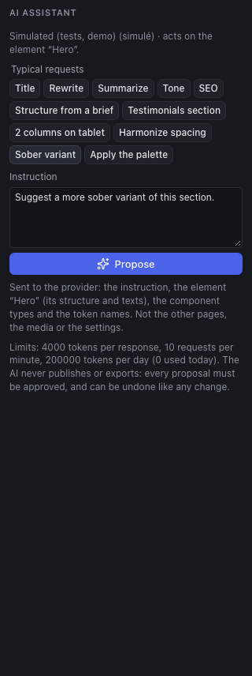
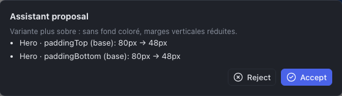

The assistant proposes changes to the site from a written instruction: rephrase a text, suggest a heading, harmonize spacing, build a section from a brief… It **never** changes the site by itself: each proposal shows as a list of changes, which you **accept** or **reject**.

## Opening the assistant

Click **AI assistant** (the sparkles) in the toolbar. The panel shows the provider and the model used, and what the assistant will act on: **the selected element**, or **the page** if nothing is selected.

> **"Assistant disabled"?** The assistant needs an access key to an AI provider (Anthropic, or an OpenAI-compatible service, local ones included), configured on the Studio's server by the administrator. Without it, the panel says so and the rest of the Studio works normally.

## Asking

1. **Select** what the request is about: a heading, a section, or nothing for the whole page. The more precise the selection, the better the proposal.
2. Choose a **typical request**, or write your **Instruction**.
3. Click **Propose**.

The typical requests:

| Request | What it does |
|---|---|
| **Title**, **Rewrite**, **Summarize** | A punchier heading, a clearer text (same meaning), a summary in one or two sentences |
| **Tone** | A warmer, more direct tone |
| **SEO** | Suggests a title and a meta description for the page |
| **Structure from a brief** | Suggests a page structure: write your brief **after** the instruction ("…from this brief: an architecture firm in Bristol, three services, a team of five") |
| **Testimonials section** | Adds a testimonials section |
| **2 columns on tablet** | Adapts a grid for tablet |
| **Harmonize spacing** | Makes the margins and spacing of the selection consistent |
| **Sober variant** | Suggests a more sober version of the section (backgrounds, margins) |
| **Apply the palette** | Applies the colors of the design system to the composition |

A typical request fills in the instruction: you can complete it ("Warmer tone, informal") before proposing. The assistant answers in the interface language and writes the site's content in the site's language.

## Reviewing, accepting, undoing

The proposal shows in a window that lists **each change**: the element, the property and the breakpoint, the old and the new value.

- **Accept** applies all the changes, as **a single action**: <kbd>⌘</kbd> <kbd>Z</kbd> undoes them all at once.
- **Reject** closes the window; the site has not moved. **Review the proposal** reopens it as long as you have not asked for another one.

The **Operation log** (clock icon) marks the operations coming from the assistant with an "AI" label.

The assistant sometimes answers with a simple **suggestion** (a text to copy by hand), with no effect on the site, or its proposal is **refused** by the Studio because it does not respect the site's rules (a misplaced component, an impossible value): rephrase the instruction or narrow the selection.

## What is sent, what is not

The panel reminds you under the instruction: the provider receives **the instruction, the selection (its structure and texts), the component types and the token names**. It receives **neither the other pages, nor the media, nor the settings**, and the access key never leaves the server.

> The texts sent go to the AI provider, often outside your country or the European Union. **Do not send personal data** (names and contact details of clients, signed testimonials…) without your client's consent.

## Limits

- Quotas prevent runaway costs: a maximum size per answer, a number of requests per minute and a daily volume, shown at the bottom of the panel.
- The assistant does not see the rendering of the page: it works on its structure. Always check the result in the canvas, on desktop and on mobile.
- It **never publishes or exports**: these actions remain yours.
- The proposals rely on a language model: proofread the texts (accuracy, tone, spelling) as you would for a copywriter.
