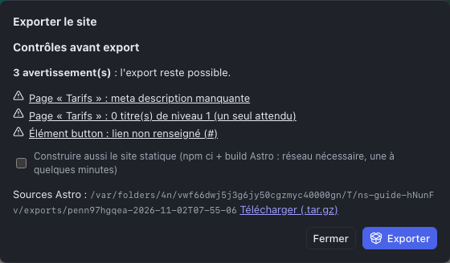

Le Studio ne met pas le site en ligne lui-même : il **exporte** des fichiers, que l’on dépose ensuite chez un hébergeur. C’est ce qui rend le site rapide, sûr et indépendant : rien ne tourne côté serveur, aucun lien ne subsiste avec le Studio.

## Avant d’exporter

- [ ] Chaque page publiée a un **titre**, une **meta description** et un seul **titre H1**.
- [ ] L’**URL canonique du site** est renseignée (inspecteur, section Site) : sans elle, pas de sitemap.
- [ ] Chaque page a été vérifiée en **Tablette** et en **Mobile**.
- [ ] Les **liens** mènent tous quelque part (pas de bouton « # »).
- [ ] Les **images** ont un texte alternatif ou sont marquées décoratives.
- [ ] Les pages de brouillon sont décochées dans **Publier**.
- [ ] Le projet est **enregistré**.

Les contrôles du Studio vérifient une bonne partie de cette liste, pas toute : le responsive et la qualité des textes restent votre regard.

## Exporter

1. Menu **⋯** (Plus d’actions) > **Exporter le site (Astro)…**
2. Lisez les **Contrôles avant export**. Les **erreurs bloquantes** empêchent l’export (une page d’accueil non publiée, un lien vers une page non publiée, un média introuvable) ; les **avertissements** le permettent. Cliquez sur une ligne pour aller à l’élément concerné, corrigez, puis rouvrez l’export.
3. Cochez **Construire aussi le site statique** : c’est lui que l’on met en ligne. La construction prend une à quelques minutes.
4. Cliquez sur **Exporter**.

Le résultat propose un ou deux liens **Télécharger (.tar.gz)** :

| Archive | Contenu | Pour qui |
|---|---|---|
| **Site statique** | Les pages HTML, le CSS, les images optimisées, le `sitemap.xml`, le `robots.txt` et la page `404.html` | L’hébergeur : c’est le site |
| **Sources Astro** | Le projet complet, lisible et documenté | Un développeur, pour reprendre ou faire évoluer le site sans le Studio |

Ignorez le chemin affiché à côté (il désigne le dossier sur le serveur du Studio). **Téléchargez tout de suite** : la fenêtre d’export ne garde pas la liste des exports précédents. Chaque export est un instantané daté : réexporter ne modifie pas un export précédent.

### Ouvrir une archive .tar.gz

- **macOS** : double-cliquez sur le fichier.
- **Windows 11** : clic droit > **Extraire tout** ; sur une version plus ancienne, avec [7-Zip](https://www.7-zip.org).

L’archive contient un dossier au nom du projet et de la date de l’export (`…-statique` pour le site statique).

## Mettre en ligne

Le site statique se dépose **à la racine** d’un domaine ou d’un sous-domaine (`www.client.fr`, `nouveau.client.fr`), pas dans un sous-dossier.

### Chez un hébergeur classique (OVH, o2switch, Ionos…)

1. Connectez-vous en **FTP** ou **SFTP** (FileZilla, Cyberduck, Transmit).
2. Ouvrez le dossier racine du site (`www`, `public_html` ou `htdocs` selon l’hébergeur).
3. **Supprimez** l’ancien contenu s’il y en a un, puis copiez **le contenu** du dossier `…-statique` (les fichiers, pas le dossier lui-même).
4. Déclarez la page d’erreur : créez ou complétez le fichier `.htaccess` à la racine avec la ligne `ErrorDocument 404 /404.html`.

### Sur Netlify ou Cloudflare Pages

Glissez le dossier `…-statique` dans l’interface de déploiement. La page 404 est reconnue automatiquement.

### Sur un serveur nginx

Copiez le contenu dans la racine du site (`root`) et ajoutez `error_page 404 /404.html;` dans le bloc `server`.

### Les redirections

Si vous avez défini des **redirections** (chapitre [Le site](06-le-site.md)), le site statique contient déjà une page à chaque ancienne adresse qui mène vers une page du site, et cette page renvoie le visiteur vers la nouvelle. Une redirection vers une adresse extérieure, elle, n’existe que dans la configuration de l’hébergeur. Pour une vraie **redirection 301**, celle que Google comprend le mieux, ajoutez la configuration de l’hébergeur. Elle se trouve dans les **sources Astro**, dossier `redirects/` :

| Hébergement | Fichier | Où le mettre |
|---|---|---|
| Apache (la plupart des hébergeurs mutualisés) | `.htaccess` | À la racine du site, en ajoutant `ErrorDocument 404 /404.html` |
| Netlify, Cloudflare Pages | `_redirects` | À la racine du dossier déployé |
| nginx | `nginx.conf` | Directives à inclure dans le bloc `server` |

## Mettre à jour le site

Modifiez le projet dans le Studio, exportez à nouveau, puis **remplacez** tous les fichiers en ligne par ceux du nouvel export. Supprimez d’abord l’ancien contenu : sinon, une page supprimée ou renommée dans le Studio resterait accessible en ligne.

## Livrer au client ou à un développeur

- **Le site statique** suffit au client qui veut seulement l’héberger.
- **Les sources Astro** permettent à n’importe quel développeur de reprendre le site sans le Studio. Leur fichier `README.md` explique comment les construire (Node.js, `npm ci`, `npm run build`), comment elles sont organisées, et liste les pages, les tokens du design system et les médias.

Une fois modifiées à la main par un développeur, les sources ne se réimportent pas dans le Studio : décidez à ce moment-là qui fait évoluer le site, le Studio ou le code.

Aucun secret ni aucun lien vers le Studio ne figure dans les fichiers exportés.

## Sauvegarder et transférer un projet

L’export produit un site ; il ne permet pas de rouvrir le projet dans le Studio. Pour cela, deux autres commandes du menu **⋯** :

- **Exporter l’archive (site et médias)** : un fichier unique qui contient tout le projet. Il se réimporte depuis l’écran Projets (**Importer (archive ou JSON)…**), dans ce Studio ou dans un autre : sauvegarde avant une grosse modification, transfert, archivage d’un site livré ;
- **Exporter JSON** : la structure du site seule, sans les médias.
