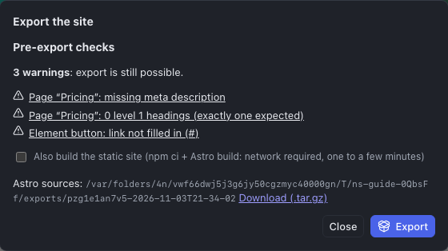

The Studio does not put the site online itself: it **exports** files, which are then uploaded to a host. That is what makes the site fast, secure and independent: nothing runs on the server, no link to the Studio remains.

## Before exporting

- [ ] Each published page has a **title**, a **meta description** and a single **H1 heading**.
- [ ] The **site's canonical URL** is filled in (inspector, Site section): without it, no sitemap.
- [ ] Each page has been checked on **Tablet** and **Mobile**.
- [ ] The **links** all lead somewhere (no "#" button).
- [ ] The **images** have an alternative text or are marked decorative.
- [ ] Draft pages are unticked in **Publish**.
- [ ] The project is **saved**.

The Studio's checks cover a good part of this list, not all of it: responsive behavior and the quality of the texts remain your judgment.

## Exporting

1. **⋯** menu (More actions) > **Export site (Astro)…**
2. Read the **Pre-export checks**. **Blocking errors** prevent the export (an unpublished home page, a link to an unpublished page, a missing media file); **warnings** allow it. Click a line to go to the element concerned, fix it, then reopen the export.
3. Tick **Also build the static site**: that is what goes online. The build takes one to a few minutes.
4. Click **Export**.

The result offers one or two **Download (.tar.gz)** links:

| Archive | Content | For whom |
|---|---|---|
| **Static site** | The HTML pages, the CSS, the optimized images, the `sitemap.xml`, the `robots.txt` and the `404.html` page | The host: it is the site |
| **Astro sources** | The complete project, readable and documented | A developer, to take the site over or evolve it without the Studio |

Ignore the path shown next to it (it designates the folder on the Studio's server). **Download right away**: the export window does not keep the list of previous exports. Each export is a dated snapshot: exporting again does not change a previous export.

### Opening a .tar.gz archive

- **macOS**: double-click the file.
- **Windows 11**: right-click > **Extract all**; on an older version, with [7-Zip](https://www.7-zip.org).

The archive contains a folder named after the project and the date of the export (`…-static` for the static site).

## Going online

The static site is uploaded **to the root** of a domain or subdomain (`www.client.com`, `new.client.com`), not into a subfolder.

### At a classic host (shared hosting)

1. Connect with **FTP** or **SFTP** (FileZilla, Cyberduck, Transmit).
2. Open the site's root folder (`www`, `public_html` or `htdocs` depending on the host).
3. **Delete** the old content if there is any, then copy **the content** of the `…-static` folder (the files, not the folder itself).
4. Declare the error page: create or complete the `.htaccess` file at the root with the line `ErrorDocument 404 /404.html`.

### On Netlify or Cloudflare Pages

Drag the `…-static` folder into the deployment interface. The 404 page is recognized automatically.

### On an nginx server

Copy the content into the site's root (`root`) and add `error_page 404 /404.html;` in the `server` block.

### Redirects

If you defined **redirects** (chapter [The site](06-the-site.md)), the static site already contains a page at each old address that leads to a page of the site, and this page sends the visitor to the new one. A redirect to an outside address only exists in the host's configuration. For a real **301 redirect**, the one Google understands best, add the host's configuration. It is in the **Astro sources**, `redirects/` folder:

| Hosting | File | Where to put it |
|---|---|---|
| Apache (most shared hosts) | `.htaccess` | At the root of the site, adding `ErrorDocument 404 /404.html` |
| Netlify, Cloudflare Pages | `_redirects` | At the root of the deployed folder |
| nginx | `nginx.conf` | Directives to include in the `server` block |

## Updating the site

Change the project in the Studio, export again, then **replace** all the online files with those of the new export. Delete the old content first: otherwise, a page deleted or renamed in the Studio would stay reachable online.

## Delivering to the client or a developer

- **The static site** is enough for a client who only wants to host it.
- **The Astro sources** let any developer take the site over without the Studio. Their `README.md` file explains how to build them (Node.js, `npm ci`, `npm run build`), how they are organized, and lists the pages, the design system tokens and the media.

Once a developer has changed the sources by hand, they cannot be imported back into the Studio: decide at that point who evolves the site, the Studio or the code.

No secret and no link to the Studio appears in the exported files.

## Backing up and transferring a project

The export produces a site; it does not let you reopen the project in the Studio. For that, two other commands of the **⋯** menu:

- **Export archive (site and media)**: a single file that contains the whole project. It is imported again from the Projects screen (**Import (archive or JSON)…**), in this Studio or another one: a backup before a big change, a transfer, archiving a delivered site;
- **Export JSON**: the structure of the site alone, without the media.
