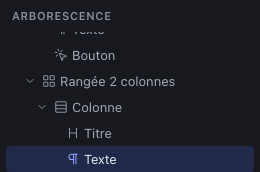
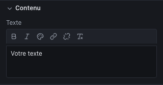

Une page du Studio est un arbre : des **conteneurs** qui contiennent d’autres conteneurs, et au bout des branches des **composants de contenu** (titres, textes, images, boutons…). Ce chapitre explique comment bâtir cet arbre ; le suivant, comment le mettre en forme.

## Penser en boîtes, pas en Section > Row > Column

Tatsu et Elementor imposent une hiérarchie fixe : une section contient des rangées, qui contiennent des colonnes, qui contiennent des modules. Le Studio n’impose rien : vous emboîtez trois types de boîtes, autant de fois que nécessaire.

| Boîte | Elle sert à | Équivalent CSS |
|---|---|---|
| **Conteneur** | Regrouper et délimiter : une section de page, une zone avec un fond, une largeur maximale | Un bloc (`<section>`, `
`…) |
| **Pile (Flex)** | Aligner des éléments **en ligne ou en colonne** : un titre et son texte, des boutons côte à côte, un visuel à droite d’un texte | Flexbox |
| **Grille** | Répartir des éléments en **colonnes égales** : cartes, galerie, logos | CSS Grid |

Quelques repères pour choisir :

- des éléments **les uns sous les autres** avec un espacement régulier : une **pile** en colonne ;
- des éléments **côte à côte** de tailles différentes (un texte large, un visuel étroit) : une **pile** en ligne ;
- des éléments **de même largeur** qui passent à la ligne : une **grille** ;
- une **section** de page avec ses marges et sa largeur maximale : un **conteneur**, ou mieux la composition **Section**.

Le **Conteneur** propose aussi une **Balise HTML** (`section`, `div`, `article`, `aside`…) : elle ne change rien à l’affichage, mais aide les moteurs de recherche et les lecteurs d’écran à comprendre la page. Une section de page se balise `<section>`, un bloc décoratif `
`.

## Les compositions : des structures toutes prêtes

Plutôt que d’emboîter les boîtes à la main, partez des **Compositions**, en bas de l’onglet **Composants** de la bibliothèque. Ce sont des structures déjà réglées, responsive comprises :

| Composition | Contenu | Sur mobile |
|---|---|---|
| **Section** | Un conteneur centré, largeur 1120 px, marges intérieures | Marges réduites |
| **Rangée 2 colonnes** | Une grille de deux colonnes (des piles) | Une colonne |
| **Rangée 3 colonnes** | Une grille de trois colonnes | Deux sur tablette, une sur mobile |
| **Hero** | Titre, texte et bouton, avec un visuel à côté | Le visuel passe dessous |
| **Carte**, **Logo**, **Appel à l’action**, **Grille d’images**, **Accordéon (FAQ)**, **Bloc d’onglets**, **Présentation**, **Atouts**, **Témoignages**, **Tarifs**, **Équipe**, **Contact** | Des sections complètes, à personnaliser | Adaptées |

Une fois insérée, une composition est un ensemble ordinaire de boîtes et de composants : vous pouvez tout modifier, ajouter ou supprimer. L’onglet **Sections** de la bibliothèque propose d’autres sections et celles que vous avez enregistrées (chapitre [Réutiliser](08-reuse.md)).

## Ajouter un élément

**Par un clic.** Un clic sur un élément de la bibliothèque l’insère :

- **dans** l’élément sélectionné, si c’est une boîte qui peut le contenir (il se place à la fin) ;
- sinon **juste après** l’élément sélectionné ;
- sinon, si rien n’est sélectionné, **à la fin de la page**.

C’est la méthode la plus précise : sélectionnez une colonne, cliquez sur **Titre** puis sur **Texte**, les deux s’ajoutent dans la colonne, l’un sous l’autre.

**Par glisser-déposer.** Faites glisser un élément de la bibliothèque dans le canvas : un repère montre où il sera déposé. Au-dessus d’un emplacement impossible, l’étiquette indique « dépôt impossible ici ».

Certaines boîtes n’acceptent que des enfants précis : un **Accordéon** ne contient que des **Éléments d’accordéon**, des **Onglets** que des **Onglets** (au singulier). Les composants de contenu (titre, texte, bouton, image…) ne contiennent rien.

## Sélectionner

- **Dans le canvas**, cliquez sur l’élément. Pour atteindre la boîte qui l’entoure, utilisez l’arborescence : un clic sur un texte sélectionne le texte, jamais sa colonne.
- **Dans l’arborescence**, cliquez sur la ligne. C’est le seul moyen d’atteindre une boîte sans fond ni marge, ou un élément masqué sur le breakpoint affiché.
- <kbd>Échap</kbd> désélectionne : l’inspecteur revient aux réglages de la page.

Donnez un **nom** à vos boîtes (inspecteur, section **Avancé**, « Nom dans l’arborescence ») : « Colonne » répété dix fois ne dit rien, « Tarif Pro » si.

## Déplacer, dupliquer, supprimer

| Pour | Faites |
|---|---|
| Changer l’ordre dans la même boîte | Flèches **Monter** / **Descendre** en haut de l’inspecteur, ou <kbd>⌥</kbd> <kbd>↑</kbd> / <kbd>⌥</kbd> <kbd>↓</kbd> |
| Déplacer ailleurs dans la page | **Attrapez l’élément dans le canvas** et glissez-le : un trait bleu montre où il va se poser, l’élément d’origine est voilé, <kbd>Échap</kbd> annule. Près du bord haut ou bas du canvas, la page défile toute seule. Ou glissez sa ligne dans l’**arborescence** ; ou **couper** (<kbd>⌘</kbd> <kbd>X</kbd>), sélectionner la destination, **coller** (<kbd>⌘</kbd> <kbd>V</kbd>) |
| Déplacer vers une autre page | Couper, ouvrir l’autre page, sélectionner la destination, coller |
| Dupliquer | <kbd>⌘</kbd> <kbd>D</kbd>, ou l’icône **Dupliquer** de l’inspecteur : la copie se place juste après |
| Supprimer | <kbd>Suppr</kbd>, ou la corbeille rouge de l’inspecteur |

Dans le canvas, c’est l’élément **sélectionné** qui se déplace si vous l’attrapez par l’intérieur (pour déplacer une boîte entière, sélectionnez-la d’abord, par exemple dans l’arborescence) ; sinon, c’est l’élément sous le pointeur. Un élément d’un composant réutilisable entraîne tout le composant. Le déplacement change l’ordre et la boîte d’accueil, jamais une position au pixel.

Le collage suit la même règle que le clic dans la bibliothèque : dans la boîte sélectionnée, sinon après l’élément sélectionné.

> Toute action s’annule avec <kbd>⌘</kbd> <kbd>Z</kbd>, y compris une suppression ou un collage.

## Les composants de contenu

| Composant | Réglages de contenu | À savoir |
|---|---|---|
| **Titre** | Texte enrichi (gras, italique, couleur, lien, retours à la ligne), **Niveau** (H1 à H6) | Le niveau est la structure du document, pas la taille : un seul H1 par page, puis H2 pour les sections, H3 dessous. La taille se règle dans le style. |
| **Texte** | Texte enrichi | Un ou plusieurs paragraphes ; gras, italique, couleur, liens et retours à la ligne. |
| **Bandeau défilant** | **Contenu** (textes ou images), **Textes**, **Séparateur**, **Images**, **Hauteur des images**, **Espacement**, **Durée d’un tour**, **Sens** | Défile en boucle, s’arrête au survol et au focus, avec un bouton **Mettre en pause**. Immobile pour les visiteurs qui ont réduit les animations. |
| **Liste** | **Puces** (disque, cercle, carré, aucune, numéros, lettres, chiffres romains), **Éléments** | Une vraie liste HTML : chaque élément est une ligne de texte enrichi (gras, italique, liens). Les numéros, lettres et chiffres romains en font une liste ordonnée. |
| **Bouton** | Libellé, Lien, **Apparence** (Principal, Secondaire, Lien texte, Lien simple) | Le **lien simple**, sans soulignement, prend la couleur environnante : pour un logo, comme dans le header. Le lien mène à une page du site, à une adresse (URL, `mailto:`, `tel:`) ou à un fichier de la médiathèque. |
| **Image** | Image, **Texte alternatif**, légende, lien, ajustement, chargement | Décrivez l’image dans le texte alternatif, ou cochez **Image décorative** si elle n’apporte rien au sens. Chapitre [Les médias](07-media.md). |
| **Galerie** | **Images** (texte alternatif et légende de chacune), **Disposition** (mosaïque ou vignettes), **Proportion des vignettes**, **Agrandir au clic** | Voir le chapitre [Les médias](07-media.md). Colonnes et espacement se règlent dans la section **Mise en page**, par taille d’écran. |
| **Carrousel** | **Images**, **Nom accessible**, **Proportion des images**, **Images visibles** (par taille d’écran), **Espacement**, **Défilement automatique** et **Intervalle** | Voir le chapitre [Les médias](07-media.md). |
| **Vidéo** | Adresse YouTube ou Vimeo, titre | Pas de fichier vidéo hébergé. |
| **Icône** | Pictogramme, **Nom accessible** | Nom vide : l’icône est décorative. |
| **Séparateur** | — | Un trait horizontal. |
| **Espaceur** | — | Un vide de hauteur réglable. Préférez l’**Espacement (gap)** des piles et grilles, plus simple à maintenir. |
| **Navigation** | Menu, libellé du bouton mobile, **Replier en bouton** (sur mobile, sur tablette et mobile, jamais) | Affiche un menu du panneau **Menus**. |
| **Liste de liens** | Menu, disposition (en colonne, en ligne) | Un menu sans bouton de repli, pour un footer par exemple. |
| **Accordéon** | — | Chaque **Élément d’accordéon** a un titre et un contenu libre. Cochez **Ouvert au chargement** pour l’éditer dans le canvas. |
| **Onglets** | Nom accessible | Chaque **Onglet** a un titre et un contenu libre. |
| **Formulaire** | Adresse d’envoi, libellé du bouton, champs cachés | Contient des **Champs**, et éventuellement des textes, titres, piles ou grilles. Voir ci-dessous. |
| **Champ** | Libellé, type, nom envoyé, obligatoire, indication | Texte, e-mail, téléphone, zone de texte, case à cocher ou liste de choix. Toujours à l’intérieur d’un Formulaire. |

### Modifier un texte directement sur la page

**Double-cliquez** sur un **Titre**, un **Texte**, un **Bouton**, une **Liste**, le titre d’un **Élément d’accordéon** ou le libellé d’un **Onglet** dans le canvas : le texte devient modifiable sur place, avec sa vraie police et sa vraie mise en page. Le cadre de sélection passe en pointillés, avec la mention « édition ».

- Tapez votre texte ; <kbd>⌘</kbd> <kbd>B</kbd> et <kbd>⌘</kbd> <kbd>I</kbd> mettent en gras et en italique (Titre et Texte).
- Dans un **Texte**, <kbd>Entrée</kbd> commence un nouveau paragraphe et <kbd>⇧</kbd> <kbd>Entrée</kbd> insère un retour à la ligne. Dans un **Titre**, <kbd>Entrée</kbd> valide et <kbd>⇧</kbd> <kbd>Entrée</kbd> insère un retour à la ligne. Dans une **Liste**, toute la liste se modifie : <kbd>Entrée</kbd> crée l’élément suivant, <kbd>⌫</kbd> en début d’élément le fusionne avec le précédent, et un élément vidé disparaît. Dans un **Bouton**, un titre d’accordéon ou un libellé d’onglet, <kbd>Entrée</kbd> valide.
- **Cliquez ailleurs** (ou appuyez sur <kbd>Entrée</kbd> quand elle valide, voir ci-dessus) pour valider ; <kbd>Échap</kbd> annule et rend le texte d’avant.
- Toute la saisie compte pour **une seule** étape : <kbd>⌘</kbd> <kbd>Z</kbd> après validation la défait d’un coup. Pendant la saisie, <kbd>⌘</kbd> <kbd>Z</kbd> et <kbd>Suppr</kbd> agissent dans le texte, jamais sur l’élément.
- Un texte collé arrive **sans sa mise en forme**.
- Dans un **composant réutilisable**, seuls les textes exposés en paramètre se modifient sur place, comme valeur propre à cette copie. Pour les autres, modifiez le composant lui-même.

Pendant la saisie dans un Titre, un Texte ou une Liste, une **barre de mise en forme** flotte au-dessus du texte (en dessous s’il est en haut de la page) : **gras**, **italique**, **couleur**, **lien**, **retirer le lien** et **effacer la mise en forme**. Sélectionnez des mots, puis cliquez sur le bouton : la saisie continue. Ces boutons fonctionnent comme ceux de l’inspecteur, décrits ci-dessous.

### Le formulaire de contact

Le plus simple : la section **Contact** de la bibliothèque (onglet **Sections**), avec un formulaire prêt à l’emploi (nom, e-mail, message, case de consentement et mention d’information).

Un site statique ne peut pas envoyer d’e-mail lui-même : le formulaire **envoie les données à une adresse**, qui s’occupe du reste. Cette adresse vient :

- d’un **service de formulaires** : [Formspree](https://formspree.io) donne une adresse `https://formspree.io/f/…` ; [Web3Forms](https://web3forms.com) donne `https://api.web3forms.com/submit` et une clé, à saisir dans un **champ caché** nommé `access_key` ;
- ou du **script de votre hébergeur ou de l’agence**.

Sélectionnez le Formulaire (arborescence) et renseignez **Adresse d’envoi** : seules les adresses `https://` sont acceptées. Tant qu’elle est vide, l’export est bloqué.

- **Champs cachés** : les valeurs demandées par certains services (clé d’accès, sujet de l’e-mail, page de remerciement). Comme l’adresse, elles sont **visibles dans le code de la page** : n’y mettez jamais de mot de passe.
- **Nom envoyé** : le nom de la donnée reçue par le service. Il suit le libellé tant que vous ne le modifiez pas, et doit être unique dans le formulaire. Gardez `email` pour l’adresse de l’internaute : les services s’en servent pour vous permettre de lui répondre.
- **Obligatoire** : le navigateur refuse l’envoi tant que le champ est vide ; une étoile s’affiche après le libellé.
- **Liste de choix** : ajoutez les choix dans **Choix de la liste** ; l’**indication** devient la première ligne (« Choisir… » par défaut).
- Demandez-vous un e-mail ? Ajoutez une **case à cocher obligatoire** de consentement (le contrôle avant export le rappelle) et vérifiez où le service héberge les données (RGPD).

Dans le canvas, un clic dans un champ le sélectionne (on n’y tape pas) ; un double-clic modifie son libellé ou celui du bouton. Dans l’**Aperçu du site**, le navigateur vérifie les champs, mais rien n’est envoyé.

### Le texte enrichi

Le champ **Texte** a une petite barre d’outils : **gras** (<kbd>⌘</kbd> <kbd>B</kbd>), **italique** (<kbd>⌘</kbd> <kbd>I</kbd>), **couleur**, **lien**, **retirer le lien** et **effacer la mise en forme**. Sélectionnez des mots, puis cliquez sur le bouton voulu.

- **Lien** ouvre un petit formulaire : choisissez une **page du site** (le lien suit ensuite ses changements d’adresse), un **fichier à télécharger** de la médiathèque, ou saisissez une **adresse** (https, http, mailto, tel ou #ancre ; une adresse de page comme `/a-propos/` devient un lien vers cette page). **Appliquer** pose le lien, <kbd>Échap</kbd> ou **Annuler** referme le formulaire.

- Dans un **Texte**, <kbd>Entrée</kbd> commence un **nouveau paragraphe** et <kbd>⇧</kbd> <kbd>Entrée</kbd> insère un **retour à la ligne**.
- Dans un **Titre**, <kbd>Entrée</kbd> insère un retour à la ligne (un titre reste un seul bloc).
- **Couleur** ouvre les couleurs du design system et un nuancier (**Autre**). La couleur choisie est enregistrée telle quelle : si vous modifiez plus tard une couleur du design system, les passages déjà colorés ne suivent pas. Pour colorer tout un élément, préférez la **Couleur du texte** de l’inspecteur, qui accepte les couleurs du design system.

Pour une énumération, utilisez le composant **Liste** : dans l’inspecteur, chaque élément a son propre champ enrichi, avec des flèches pour le déplacer, une corbeille pour le supprimer et **Ajouter un élément** en bas. Les intertitres dans un texte ne sont pas disponibles : utilisez un composant **Titre** entre deux **Texte**, ce qui garde la hiérarchie des titres correcte.

## Bonnes habitudes

- **Commencez par la structure**, puis le contenu, puis la mise en forme. Une page bien découpée en sections nommées se modifie en quelques clics ; une page de boîtes anonymes devient vite un labyrinthe.
- **Une section = un conteneur** (ou la composition Section), avec la balise `<section>`.
- **Des titres dans l’ordre** : H1, puis H2, puis H3, sans sauter de niveau. L’export vous signale une page sans H1.
- **Pas de boîtes vides pour faire de l’espace** : réglez plutôt les espacements (chapitre suivant).
