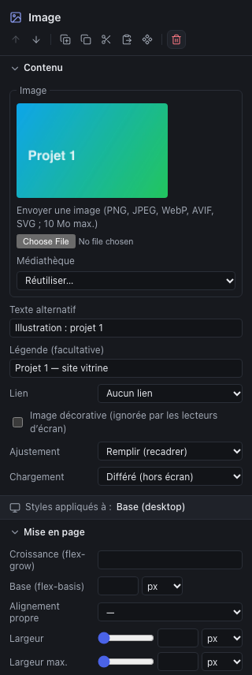
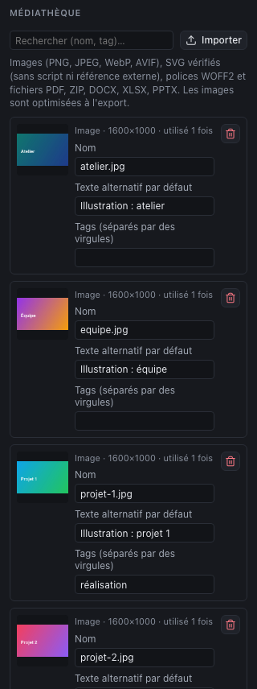

Chaque projet a sa **médiathèque** : les images, SVG et fichiers à télécharger du site. Contrairement à WordPress, elle n’est pas partagée entre les projets.

## Formats acceptés

| Type | Formats | Taille max. | À l’export |
|---|---|---|---|
| **Images** | PNG, JPEG, WebP, AVIF | 10 Mo | Optimisées automatiquement (voir plus bas) |
| **SVG** | SVG | 1 Mo | Copiés tels quels. Le Studio refuse les SVG qui contiennent un script ou appellent une ressource externe |
| **Polices** | WOFF2 | 2 Mo | Livrées avec le site (voir [Le design system](05-design-system.md)) |
| **Fichiers** | PDF, ZIP, DOCX, XLSX, PPTX | 20 Mo | Copiés tels quels, à proposer en téléchargement |

Les vidéos ne s’importent pas : le composant **Vidéo** affiche une vidéo YouTube ou Vimeo à partir de son adresse.

## Ajouter une image dans une page

1. Insérez un composant **Image** (bibliothèque, onglet Composants, catégorie Médias), ou sélectionnez une image existante.
2. Dans l’inspecteur, section **Contenu** :
   - **Envoyer une image** : choisissez le fichier, saisissez son **texte alternatif** (ou cochez **Image décorative**), puis **Ajouter l’image**. L’image entre dans la médiathèque et s’affiche ;
   - ou **Médiathèque > Réutiliser…** : choisissez une image déjà importée.

Les autres réglages de l’image :

| Réglage | Rôle |
|---|---|
| **Texte alternatif** | Ce que lit un lecteur d’écran, et ce qui s’affiche si l’image ne charge pas. Obligatoire, sauf image décorative |
| **Légende (facultative)** | Un texte affiché sous l’image |
| **Lien** | Rend l’image cliquable : une page, une adresse ou un fichier |
| **Image décorative** | L’image n’apporte rien au sens (motif, illustration d’ambiance) : les lecteurs d’écran l’ignorent |
| **Ajustement** | **Remplir (recadrer)** : l’image couvre toute sa boîte, quitte à être coupée. **Contenir** : l’image entière est visible, avec des bandes si les proportions diffèrent |
| **Chargement** | **Différé** : chargée à l’approche de l’écran (par défaut). **Immédiat** : pour l’image principale en haut de page, qui doit s’afficher tout de suite |

Dans les styles, **Proportions** (16:9, carré…) et **Cadrage de l’image** (centre, haut, bas…) règlent le recadrage quand l’ajustement est sur « Remplir ».

## Les galeries

Le composant **Galerie** (bibliothèque, catégorie Médias) présente une série d’images, comme un portfolio :

- **Images** : ajoutez-les depuis la médiathèque (**Ajouter depuis la médiathèque**) ou importez-en plusieurs d’un coup (**Importer des images…**). Chacune a son **texte alternatif** (vide : image décorative) et sa **légende** facultative ; les flèches changent l’ordre.
- **Disposition** : **Mosaïque** garde la hauteur naturelle de chaque image, en colonnes décalées ; **Vignettes** recadre toutes les images à la même **proportion** (carré, 4:3, 16:9…).
- **Colonnes** et **Espacement**, dans la section **Mise en page** de l’inspecteur, se règlent par taille d’écran : trois colonnes sur ordinateur, deux sur tablette, une sur mobile par défaut.
- **Agrandir au clic** : un clic ouvre l’image en grand sur fond sombre, avec l’image précédente et la suivante (flèches du clavier), et <kbd>Échap</kbd> pour fermer. Sans JavaScript, le lien ouvre simplement l’image.

En mosaïque, les images se lisent colonne par colonne. L’ordre de la liste reste celui que suivent le clavier et les lecteurs d’écran : placez d’abord les images les plus importantes. Les images sont optimisées à l’export comme celles du composant Image.

## Les carrousels

Le composant **Carrousel** (catégorie Médias) fait défiler une série d’images à l’horizontale :

- **Images** : comme pour la galerie, avec texte alternatif et légende ; **Nom accessible** décrit l’ensemble (« Nos réalisations »).
- **Images visibles** : une par défaut ; tablette et mobile reprennent la valeur de l’écran plus grand quand le champ est vide. **Espacement** sépare les images, **Proportion des images** les recadre (ou garde leur forme d’origine).
- Les boutons **‹** et **›** passent à l’image précédente ou suivante, en revenant au début après la dernière. On peut aussi faire glisser au doigt, ou utiliser les flèches du clavier une fois le carrousel sélectionné. Sans JavaScript, la bande reste défilable.
- **Défilement automatique** : facultatif et désactivé par défaut. Il s’arrête au survol, au focus et avec le bouton **Pause**, et ne s’active jamais pour les visiteurs qui ont réduit les animations. Le canvas ne défile pas tout seul ; l’aperçu du site, si.

Un carrousel cache la plupart de ses images : pour un contenu important, une galerie ou une grille reste plus lisible.

### Bien écrire un texte alternatif

- Décrivez ce que l’image **apporte**, en une phrase : « Atelier lumineux avec trois postes de travail », pas « image » ni « photo-atelier-03.jpg ».
- Pour une image-lien, décrivez la **destination** : « Voir le projet Boulangerie Martin ».
- Une image qui contient du texte : reprenez le texte.
- Une image purement décorative : cochez **Image décorative** plutôt que d’écrire un texte vide de sens.

Une image de la médiathèque peut aussi servir d’**image de fond** à une boîte (chapitre [Mise en forme](04-styling-and-responsive.md)) : elle est alors publiée sans optimisation, préparez-la en conséquence.

## La médiathèque

Le bouton **Médiathèque** (icône d’images) de la barre d’outils ouvre le panneau du projet.

- **Importer** : un ou plusieurs fichiers d’un coup (images, SVG, documents).
- **Rechercher** : par nom, nom de fichier ou tag.
- Pour chaque média : sa **taille**, l’indication **utilisé N fois** ou **inutilisé**, un **Nom**, un **Texte alternatif par défaut** (proposé quand on choisit l’image dans un composant) et des **Tags** pour s’y retrouver (« réalisation », « équipe »…).
- La corbeille **retire** un média de la médiathèque. Un média encore utilisé ne peut pas être retiré : le Studio indique combien d’éléments s’en servent.

Pour proposer un document en téléchargement, importez-le dans la médiathèque, puis choisissez-le dans le **Lien** d’un bouton, d’une image ou d’une entrée de menu (groupe « Fichier à télécharger »).

## Préparer ses images

Le Studio optimise les images à l’export : il les convertit en **WebP** et en produit plusieurs largeurs (480, 960 et 1600 px, sans jamais agrandir l’original). Le navigateur du visiteur charge la plus petite qui suffit à son écran. Vous n’avez donc pas à préparer plusieurs versions, mais :

- **importez une seule version, assez grande** : 1600 px de large pour une image pleine largeur, 800 px pour une demi-largeur ; au-delà, c’est du poids inutile ;
- **recadrez avant d’importer** quand le cadrage compte : le recadrage du Studio (Remplir, Cadrage) reste approximatif ;
- **préférez le SVG** pour les logos et pictogrammes : net à toutes les tailles, très léger ;
- **nommez vos fichiers** clairement (`atelier-postes-de-travail.jpg`) : le nom est conservé dans les sources exportées.

## Limites actuelles

- Pas de dossiers, de remplacement d’un fichier par une nouvelle version, ni de nettoyage automatique des médias inutilisés : retirez-les à la main (indication « inutilisé »).
- Pas de vidéo hébergée.
- Pour réutiliser une image dans un autre projet, il faut l’importer à nouveau.
