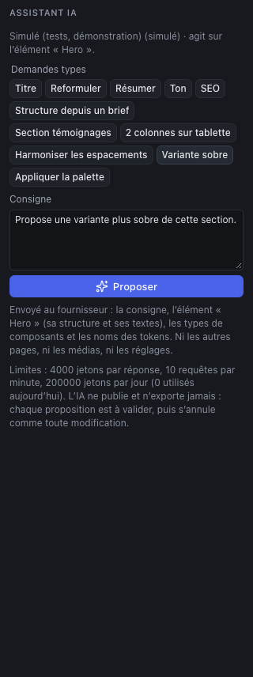
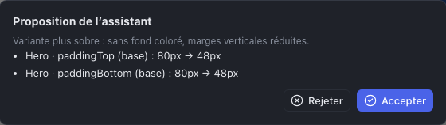

L’assistant propose des modifications du site à partir d’une consigne écrite : reformuler un texte, proposer un titre, harmoniser des espacements, construire une section à partir d’un brief… Il ne modifie **jamais** le site de lui-même : chaque proposition s’affiche sous forme de liste de changements, que vous **acceptez** ou **rejetez**.

## Ouvrir l’assistant

Cliquez sur **Assistant IA** (les étincelles) dans la barre d’outils. Le panneau indique le fournisseur et le modèle utilisés, et sur quoi l’assistant va agir : **l’élément sélectionné**, ou **la page** si rien n’est sélectionné.

> **« Assistant désactivé » ?** L’assistant demande une clé d’accès à un fournisseur d’IA (Anthropic, ou un service compatible OpenAI), configurée sur le serveur du Studio par l’administrateur. Sans elle, le panneau l’indique et le reste du Studio fonctionne normalement.

## Demander

1. **Sélectionnez** ce sur quoi porte la demande : un titre, une section, ou rien pour la page entière. Plus la sélection est précise, meilleure est la proposition.
2. Choisissez une **demande type**, ou écrivez votre **Consigne**.
3. Cliquez sur **Proposer**.

Les demandes types :

| Demande | Ce qu’elle fait |
|---|---|
| **Titre**, **Reformuler**, **Résumer** | Un titre plus percutant, un texte plus clair (même sens), un résumé en une ou deux phrases |
| **Ton** | Un ton plus chaleureux et direct |
| **SEO** | Propose un titre et une meta description pour la page |
| **Structure depuis un brief** | Propose une structure de page : écrivez votre brief **à la suite** de la consigne (« …à partir de ce brief : un cabinet d’architectes à Lille, trois services, une équipe de cinq ») |
| **Section témoignages** | Ajoute une section de témoignages |
| **2 colonnes sur tablette** | Adapte une grille pour la tablette |
| **Harmoniser les espacements** | Uniformise les marges et espacements de la sélection |
| **Variante sobre** | Propose une version plus sobre de la section (fonds, marges) |
| **Appliquer la palette** | Applique les couleurs du design system à la composition |

Une demande type remplit la consigne : vous pouvez la compléter (« Ton plus chaleureux, en vouvoyant ») avant de proposer.

## Examiner, accepter, annuler

La proposition s’affiche dans une fenêtre qui liste **chaque changement** : l’élément, la propriété et le breakpoint, l’ancienne et la nouvelle valeur.

- **Accepter** applique tous les changements, en **une seule action** : <kbd>⌘</kbd> <kbd>Z</kbd> les annule tous d’un coup.
- **Rejeter** ferme la fenêtre ; le site n’a pas bougé. **Revoir la proposition** la rouvre tant que vous n’en avez pas demandé une autre.

Le **Journal des opérations** (icône d’horloge) marque les opérations venant de l’assistant d’une étiquette « IA ».

Il arrive que l’assistant réponde par une simple **suggestion** (un texte à reprendre à la main), sans effet sur le site, ou que sa proposition soit **refusée** par le Studio parce qu’elle ne respecte pas les règles du site (un composant mal placé, une valeur impossible) : reformulez la consigne ou précisez la sélection.

## Ce qui est envoyé, ce qui ne l’est pas

Le panneau le rappelle sous la consigne : le fournisseur reçoit **la consigne, la sélection (sa structure et ses textes), les types de composants et les noms des tokens**. Il ne reçoit **ni les autres pages, ni les médias, ni les réglages**, et la clé d’accès ne quitte jamais le serveur.

> Les textes envoyés partent chez le fournisseur d’IA, souvent hors de l’Union européenne. **N’envoyez pas de données personnelles** (noms et coordonnées de clients, témoignages signés…) sans l’accord de votre client.

## Limites

- Des quotas évitent les dérapages de coût : une taille maximale par réponse, un nombre de demandes par minute et un volume par jour, affichés en bas du panneau.
- L’assistant ne voit pas le rendu de la page : il travaille sur sa structure. Vérifiez toujours le résultat dans le canvas, sur desktop et sur mobile.
- Il **ne publie et n’exporte jamais** : ces actions restent les vôtres.
- Les propositions s’appuient sur un modèle de langage : relisez les textes (exactitude, ton, orthographe) comme vous le feriez pour un rédacteur.
