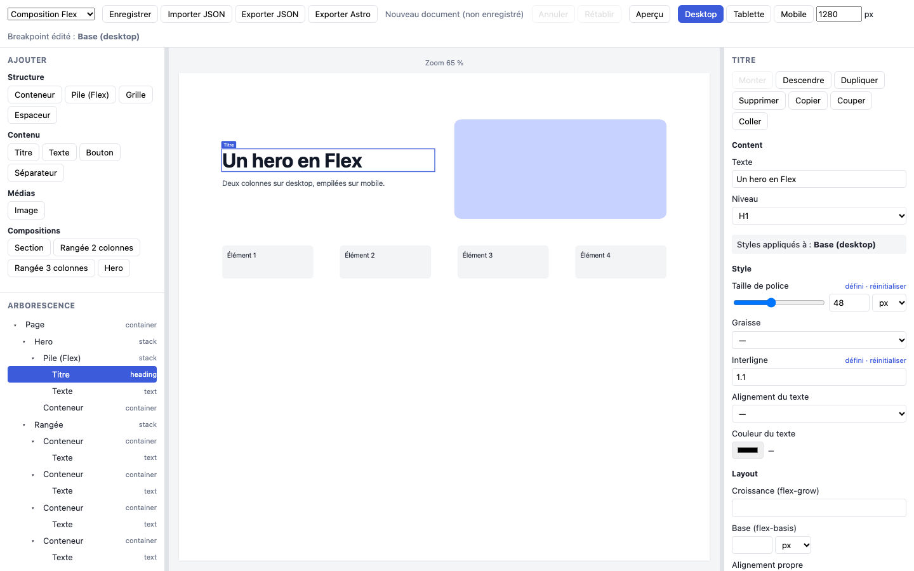
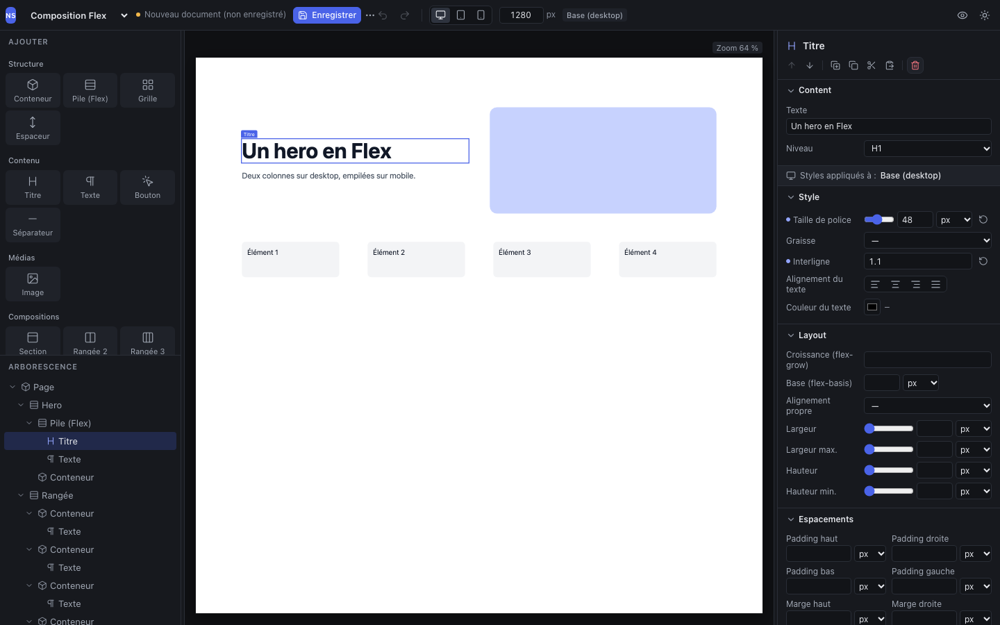
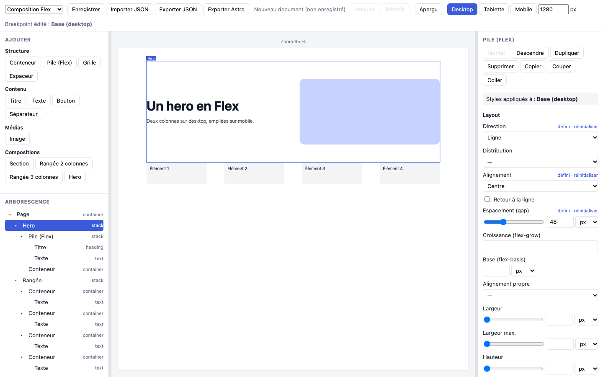
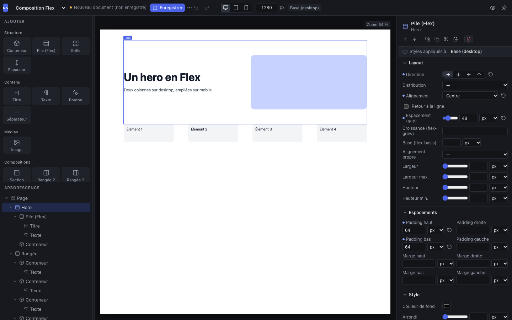
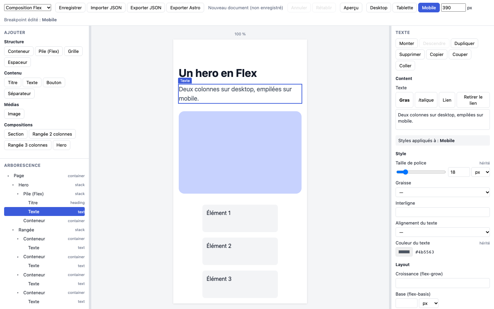
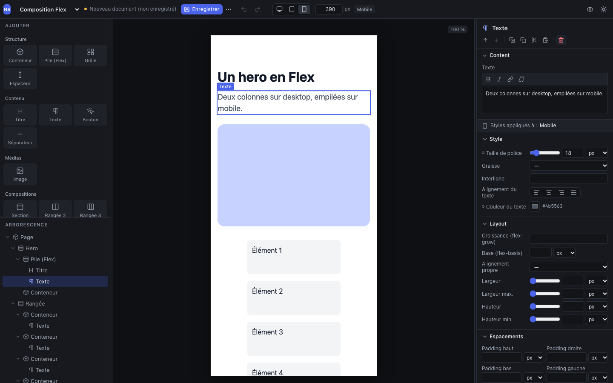
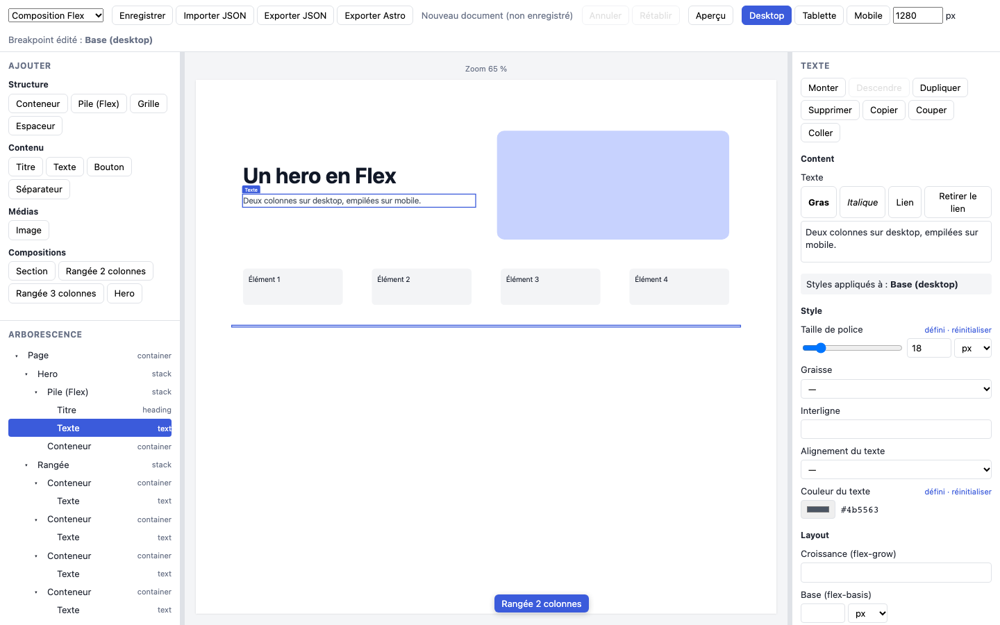
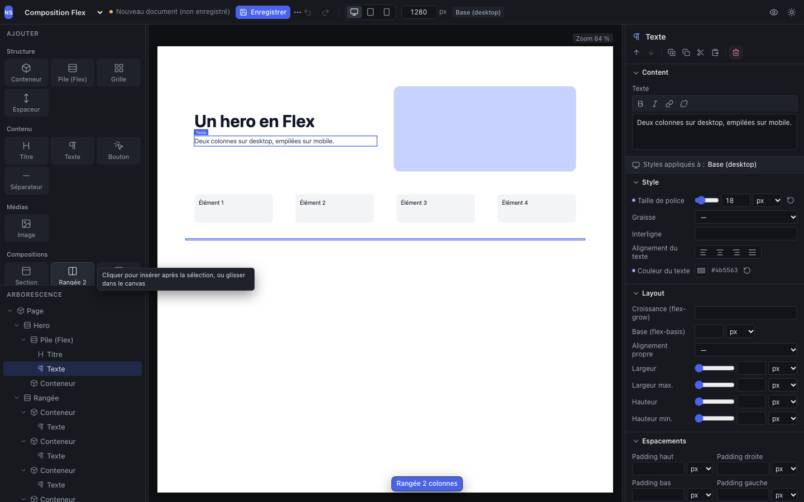
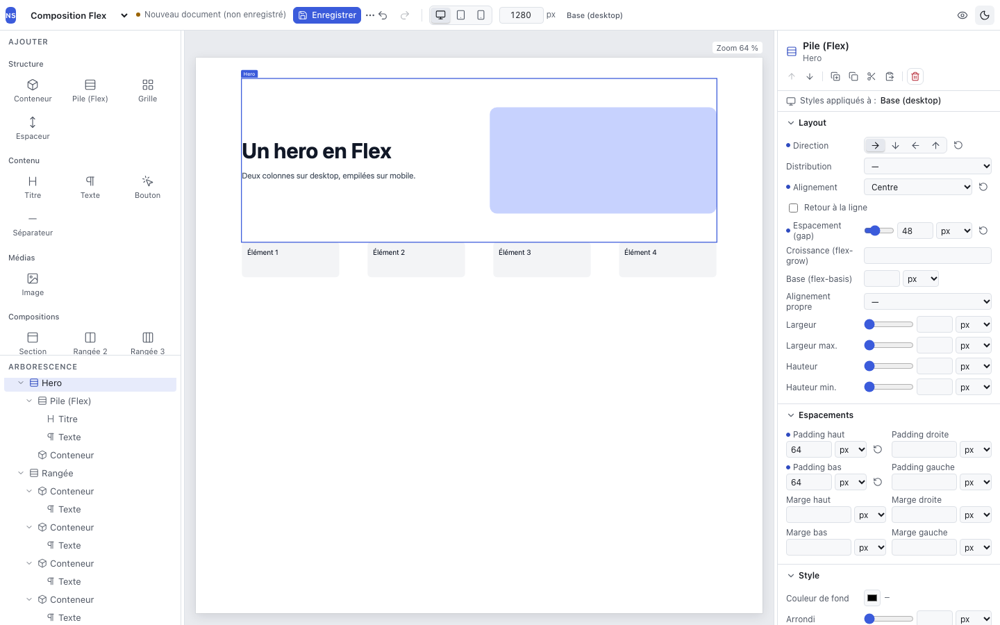

# Studio design system

**Scope:** the editor interface only (`apps/studio/src/ui/`, `apps/studio/src/shell/`). Exported sites and the canvas do not depend on it, which `apps/studio/src/isolation.test.ts` checks. Decision: [ADR-0006](../architecture/adr/ADR-0006-studio-design-system.md).

## 1. Initial audit (10/29/2026)

| Area | Finding |
|---|---|
| Styles | A single `shell.css` (456 lines, 80 rules) with only 8 color variables, and hard-coded colors in the canvas. Implicit light theme, no dark theme. No typographic or spacing scale. |
| Toolbar | Text buttons (Save, Import JSON, Export JSON, Export Astro, Undo, Redo, Preview, Desktop, Tablet, Mobile) on one or two lines. Notifications inserted into the bar. |
| Library | Inline text buttons, without icons. |
| Tree | Label followed by the type as text; ▾/▸ chevrons as characters. |
| Inspector | Labels above each control (not dense), actions as text buttons, sections not collapsible. "set · reset" / "inherited" texts next to the labels. Selects for every choice. |
| Rich text | "Bold", "Italic", "Link", "Remove link" buttons as text. |
| States | Minimal hover, focus and disabled; no marked selection in grouped controls. |

Before/after screenshots: see §5.

## 2. Tokens (`ui/tokens.css`)

Components use semantic tokens only. A theme is therefore one override block: `:root` for dark (the default), `:root[data-theme='light']` for light.

| Family | Tokens |
|---|---|
| Surfaces | `--bg-app` (canvas background), `--bg-panel`, `--bg-elevated` (menus, tiles), `--bg-hover`, `--bg-active`, `--bg-input` |
| Lines | `--border`, `--border-strong` |
| Text | `--text`, `--text-muted`, `--text-subtle` (contrast ≥ 4.5:1 on panel surfaces) |
| Accent | `--accent` and `--accent-fg` (solid surfaces, ≥ 4.5:1), `--accent-text` (text on a panel), `--accent-soft` (selection) |
| States | `--danger`, `--danger-bg`, `--success`, `--warning`, `--focus-ring` |
| Canvas | `--overlay-hover`, `--overlay-selected` |
| Typography | `--font-ui` (system fonts), `--font-mono`; sizes `--text-xs` 11, `--text-sm` 12, `--text-md` 13, `--text-lg` 14; `--leading` 1.4; weights 500 / 600 |
| Spacing | 4 px grid with half steps: `--space-1` 2 … `--space-7` 24 |
| Dimensions | `--control-h` 28, `--control-h-sm` 24, `--toolbar-h` 44 |
| Radii | `--radius-sm` 4, `--radius-md` 6, `--radius-lg` 8 |
| Shadows | `--shadow-popover`, `--shadow-frame` |
| Motion | `--transition` 120 ms, brought to 0 with `prefers-reduced-motion`. Transitions are also cut during a theme change (`.no-transitions`). |

## 3. Primitives (`ui/`)

| Primitive | Role | Behavior |
|---|---|---|
| `Button` | Text button, `default`, `ghost`, `primary`, `danger` variants, `sm`/`md` sizes, optional icon | Native `<button>` |
| `IconButton` | Icon-only button | `label` required: accessible name and tooltip (with shortcut) |
| `Tip` | Tooltip | Radix Tooltip: hover **and** keyboard focus, Escape |
| `Segmented` | Compact single choice (preview width, direction, text alignment) | Radix ToggleGroup: radio semantics, arrows (asynchronous roving focus); native `title` tooltip |
| `Menu` | Drop-down menu with an icon trigger | Radix DropdownMenu: arrows, type-ahead, Escape, focus return |
| `Section` | Collapsible inspector section | Native `
`/`
` |
| `Field` | Inspector row: label on the left, control, action | "set / inherited" status dot with a text alternative; stacked variant |
| `icons.ts` | Icon per component type and per composition | `lucide-react`, `aria-hidden` |

**Usage rules**

- No hard-coded color in `shell.css`. Only `#ffffff` is allowed, for the page background and the text of the overlay label, which sit on the site itself; a test checks it.
- An action without visible text goes through `IconButton`, so that it always has a name and a tooltip.
- The accessible name of a control with visible text must contain that text (WCAG 2.5.3, checked by axe).
- No Radix tooltip on an element that already carries a Radix `data-state` (ToggleGroup items): the attributes collide.
- No hard-coded text: labels go through `t()` (ADR-0024).
- New primitive: only if it serves at least two places, or brings an accessible behavior.

## 4. Checks (at the time of the audit)

| Check | Result |
|---|---|
| `npm run check` | 71 unit tests, including isolation: canvas without UI, icons or Radix, export template and components unchanged, tokens confined |
| `npm run test:e2e` | 26/26; added: tooltip with shortcut, segmented control with the keyboard and light theme audited by axe |
| Accessibility | axe (WCAG 2.1 AA, serious violations): 0 in dark as in light theme |
| `npm run test:fidelity` | 20/20 identical: rendering and export unaffected |
| `npm run demo` | Succeeded |
| Bundle | Icons and Radix are only in the shell bundle (`index-*.js`: 159 KB, 51 KB gzip, against 20 KB before). The canvas bundle did not change. |

Problems found along the way:

- Contrast of the overlay label: `--overlay-selected` darkened.
- Color transitions caught by axe during the theme change: cut during the switch.
- `data-state` collision between Tooltip and ToggleGroup, which canceled the visual selected state.
- Text field squashed in the stacked layout.
- Composition tiles truncated.

## 5. Screenshots (1440 × 900, `node tests/e2e/screens.ts <prefix>`)

| State | Before | After |
|---|---|---|
| Heading selected |  |  |
| Container (layout) |  |  |
| Mobile, rich text |  |  |
| Drag and drop |  |  |
| Light theme | — |  |

## 6. Limits and next steps

- **Native selects**, styled, rendered by the system once open. A Radix Select would only bring visual consistency, at the cost of one more dependency.
- **Theme** not synchronized with `prefers-color-scheme`: an explicit, remembered choice.
- **Color field.** The native picker shows neither alpha nor palette; token colors are offered next to it.
- **Spacing** as a grid of fields. A Figma-like "box" widget remains possible.
